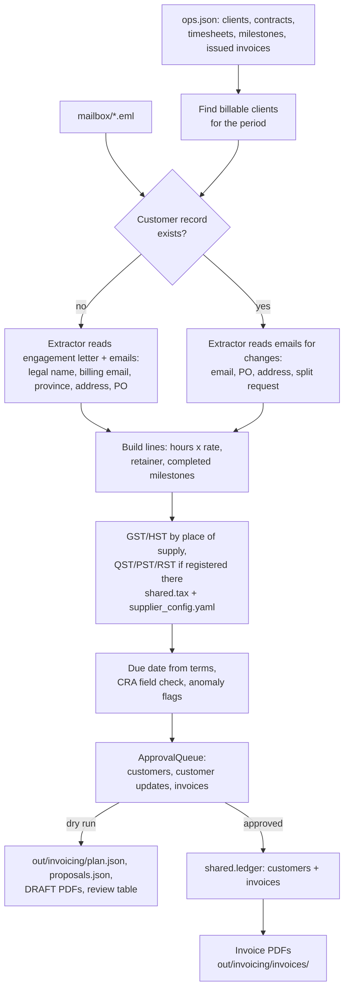

# 01 Invoicing: month-end client invoicing

## The job

A small Canadian professional-services firm bills its clients around the 25th of each month. Someone pulls the month's timesheets, retainers and completed milestones out of the ops system, works out who to bill, sets up any new clients from their engagement letters and emails, applies the right GST/HST rate (and QST, PST or RST where the firm is registered for it), and issues invoices with the details the CRA expects. Clients also send billing changes by email (a new AP address, a new PO, a move, "please split this into two invoices") that have to be applied first.

This module does the reading, maths and drafting, and stops at an approval queue. Nothing reaches the ledger and no final PDF is produced until a person approves it.

## Workflow



## What is automated and what the person approves

| Step | Who | How |
|---|---|---|
| Find billable clients and contracts active in the period | Code | `invoicing.plan_month` |
| Read engagement letters and emails for billing details | Model or rules | `invoicing_extract.py` (`ClaudeExtractor` / `RulesExtractor`) |
| Invoice lines, rounding, GST/HST, due dates, numbering | Code | `invoicing.py`, `shared/tax.py`; cents, half-up rounding |
| QST, PST or RST, where the supplier is registered in the customer's province | Code | `invoicing.provincial_tax_for`, registrations in `supplier_config.yaml` |
| Anomaly flags and CRA field check | Code | see below |
| New customers and changes to existing customers | **Person** | `customer` / `customer_update` proposals |
| Each invoice | **Person** | `invoice` proposals; an invoice is held if its customer proposal was not approved |
| Writing to the ledger, rendering final PDFs | Code, after approval | `invoicing.commit` |
| Sending invoices to clients | **Person**, outside this module | not implemented |

`--auto-approve` is for demos: it approves unflagged items and holds every flagged one.

### Flags

Any flag holds the item for a person:

- active retainer with no logged activity in the period
- timesheet rate differs from the contract rate (billed at the contract rate; the flag lists the entries)
- hourly total over the contract's not-to-exceed cap
- missing billing email
- duplicate: an invoice for this client and period is already in the ops system or the ledger
- PO required by the contract but none on file or in email
- bill-to province differs from the contract's province (place of supply needs confirming)
- legal name or province not found for a new client (fallback values are used and flagged)
- split requested but only one billable contract; mixed payment terms on one invoice
- non-CAD contract; CRA-required invoice fields missing for the invoice's amount tier
- PST or RST charged (BC, SK, MB): those taxes cover goods and a listed set of services only, so a person confirms the service is taxable there; also raised if no registration number is on file
- QST charged on an invoice of $100 or more while the supplier's QST number in `supplier_config.yaml` is missing or not 10 digits + `TQ` + 4 digits

## Provincial sales tax

`supplier_config.yaml` lists the supplier's provincial registrations. The synthetic supplier is registered for QST in Quebec and PST in British Columbia, and not in Saskatchewan or Manitoba. For each invoice:

- the customer's bill-to province is the place of supply, as for GST/HST;
- if the supplier is registered there, `provincial_tax_for` charges QST (9.975%), BC PST (7%), SK PST (6%) or MB RST (7%) on the subtotal before GST, rounded half-up (`shared/tax.py`, which cites each rate's official page);
- if it is not registered there, or the province has HST, only GST/HST is charged.

The tax is stored apart from GST/HST, in `invoices.provincial_tax_cents` and `invoices.provincial_tax_code`, because it goes to a different authority. The PDF prints it on its own line and prints the supplier's registration number for it under the GST/HST number. On the October run this gives the Quebec milestone invoice $18,000.00 + GST $900.00 + QST $1,795.50 = $20,695.50, and the BC hourly invoice a 7% PST line (flagged for the taxability check). The Saskatchewan and Manitoba clients get GST only.

Whether the supplier has to register for a provincial tax is not decided here. Set `supplier_config.yaml` from its actual registrations.

## Run it

```bash
uv run python 01_invoicing/invoicing_data.py          # regenerate synthetic data (seed 42)
uv run python 01_invoicing/run.py                     # dry run for 2026-10
uv run python 01_invoicing/run.py --approve           # review each proposal (y/N)
uv run python 01_invoicing/run.py --auto-approve      # demo
AFO_LLM_MODE=live ANTHROPIC_API_KEY=... uv run python 01_invoicing/run.py --extractor claude
uv run python evals/eval_invoicing.py                 # extraction accuracy
```

Outputs go to `out/invoicing/`: `plan.json`, `proposals.json` (with decisions), `drafts/*-DRAFT.pdf` on a dry run, and `ledger.db` plus `invoices/*.pdf` after approval. On a re-run the agent continues invoice numbering after the ledger's highest number and flags any client already invoiced for the period.

## Synthetic data

`invoicing_data.py` writes everything under `data/synthetic/invoicing/` with Faker (`en_CA`, seed 42). The supplier, clients, people and GST/HST number are made up; email domains end in `.test`. The QST and PST numbers in `supplier_config.yaml` are made up too.

- `ops.json`: a mock ERP export with 20 clients and 21 contracts (hourly, retainer, milestone). Each anomaly above appears at least once.
- `mailbox/`: the month's threads. Four new clients send billing details, four existing clients send changes, and one email is unrelated.
- `eval/cases.json` and `eval/labels.json`: 37 labelled extraction cases. Labels come from the same generator that writes the text, so they are exact. Nine of the cases (`kind` ending in `_heldout`) use phrasings added after the rules baseline was written. Three more (`new_client_quebec`) were added with QST support: a bill-to address in the French Canadian order ("Montréal (Québec) H3B 2R1"), a province spelled "Québec" with an accented city, and an email that gives the client's QST number. None of these twelve were used to tune the baseline. The Quebec cases are generated after everything else, so `ops.json` and the earlier cases did not change when they were added.

## Model use

The model is used for one task: reading free-text contracts and emails into a fixed schema (`invoicing_extract.SCHEMA`). The system prompt (`invoicing_extract.SYSTEM`) tells the model to:

- return null rather than guess;
- prefer later corrections over earlier instructions and quoted text;
- never return the supplier's own details;
- quote evidence for each field it fills.

Tax, rounding, dates and numbering never go through the model.

No API key was available when this module was built, so `fixtures/` holds no recorded responses and none were written by hand. In the default `replay` mode, the agent, the tests and CI use `RulesExtractor`. Setting `AFO_LLM_MODE=record` with a key records real responses into `01_invoicing/fixtures/`. After that, `--extractor claude` replays them.

## Eval

`evals/eval_invoicing.py` measures per-field accuracy on the 37 cases. A field counts as correct when the normalised prediction matches the label, including when both are null. Current numbers for `RulesExtractor` (from `uv run python evals/run_all.py`):

| field | accuracy |
|---|---|
| legal_name | 0.946 |
| billing_email | 0.946 |
| province | 0.946 |
| address | 0.865 |
| po_number | 0.973 |
| split_invoices | 0.973 |
| mean over fields | 0.941 |
| cases with every field right | 0.703 |

The baseline misses 13 fields. Five are on the Quebec cases: it reads neither the French-order address nor the accented "Montréal", so province and address come back empty, and on the third case it returns a run of the email starting at the client's GST number as the address. Province decides whether QST is charged, so a missed Quebec province is a tax error, not just a data-entry one. Seven of the other eight misses are on the held-out phrasings:

- "route your bills to"
- "registered as"
- a unit number that comes before the street
- a split request that doesn't use the word "split"

The other miss is the "old PO closed, new PO is ..." email, where the rules take the first PO they see. The baseline was written against the same templates that generate the rest of the set, so its scores there overstate how it would do on real mail. The `ClaudeExtractor` is scored only when `AFO_LLM_MODE` is `live` or `record`. No Claude numbers are reported yet.

## Regulatory references

- **Invoice contents by amount.** The CRA lists the information an invoice must carry for the customer to claim an input tax credit. It depends on the total, tax included:
  - under $100: supplier name, date and total;
  - $100 to $499.99: add the supplier's GST/HST registration number and the GST/HST charged, or a statement that the price includes it;
  - $500 or more: add the customer's name, the payment terms and a description of each supply.

  Sources: [CRA, Input tax credits: information required on invoices](https://www.canada.ca/en/revenue-agency/services/tax/businesses/topics/gst-hst-businesses/calculate-prepare-report/input-tax-credit.html), and [Input Tax Credit Information (GST/HST) Regulations, SOR/91-45, s. 3](https://laws-lois.justice.gc.ca/eng/regulations/SOR-91-45/section-3.html).

  These $100 and $500 thresholds replaced the older $30 and $150 thresholds. Some guides, including the older [GST/HST Memorandum 8-4](https://www.canada.ca/en/revenue-agency/services/forms-publications/publications/8-4/documentary-requirements-claiming-input-tax-credits.html), still show the old figures.

  `invoicing.CRA_FIELDS_BY_TIER` encodes the current tiers, and `check_cra_fields` flags any gaps. The PDF always prints the full $500+ set: supplier name and GST/HST number, invoice date, customer legal name, line descriptions, payment terms, the GST/HST label and amount, and the total.
- **QST and provincial sales taxes.** Rates and sources are in `shared/tax.py`: Revenu Québec, [Calculating the Taxes](https://www.revenuquebec.ca/en/businesses/consumption-taxes/gsthst-and-qst/collecting-gst-and-qst/calculating-the-taxes/) (QST 9.975% of the price excluding GST) and [Preparing Invoices](https://www.revenuquebec.ca/en/businesses/consumption-taxes/gsthst-and-qst/collecting-gst-and-qst/preparing-invoices/); [BC PST](https://www2.gov.bc.ca/gov/content/taxes/sales-taxes/pst); [Saskatchewan PST](https://www.saskatchewan.ca/business/taxes-licensing-and-reporting/provincial-taxes-policies-and-bulletins/provincial-sales-tax); [Manitoba RST](https://www.gov.mb.ca/finance/taxation/taxes/retail.html). revenuquebec.ca refused automated fetches while this was built, so the QST details were taken from search summaries of those pages; check them before relying on this.
- **Charging GST/HST.** Suppliers must show their GST/HST account number on invoices for taxable supplies of $100 or more ([CRA, RC4022 General Information for GST/HST Registrants](https://www.canada.ca/en/revenue-agency/services/forms-publications/publications/rc4022/general-information-gst-hst-registrants.html)).
- **Rates and place of supply.** Rates come from `shared/tax.py`, which cites the [CRA GST/HST rate calculator](https://www.canada.ca/en/revenue-agency/services/tax/businesses/topics/gst-hst-businesses/charge-collect-which-rate/calculator.html). For services, the module uses the province of the customer's bill-to address as the place of supply. This is a simplification of the CRA's rules for services ([GST/HST Memorandum 3-3-6, Place of Supply in a Province: General Rules for Services](https://www.canada.ca/en/revenue-agency/services/forms-publications/publications/3-3-6/plc-spply-prvnc-gnrl-rls-fr-srvcs.html), which replaced draft bulletin B-103).

## Limitations

- **Place of supply.** It is taken from the bill-to address only. Memo 3-3-6 has further rules, for example where the services are performed in more than one province or relate to real property. A mismatch with the contract province is flagged, not resolved.
- **Provincial sales tax taxability.** Every supply is treated as taxable wherever the supplier is registered. QST follows the GST base closely, but BC PST, SK PST and MB RST cover only listed services, so those invoices are flagged rather than decided. Whether the supplier must register in a province is not assessed, and the QST invoice-content requirements are checked only for the supplier's QST number.
- **Updating customers.** `upsert_customer` does not update existing rows, so approved customer changes go through a local `update_customer` helper that runs SQL against the ledger's `customers` table.
- **Matching emails to clients.** Emails are matched by sender domain. Mail from a personal or shared domain will not be matched.
- **Splitting invoices.** A split request is applied as one invoice per contract. Any other split, such as by cost centre within one contract, needs a person.
- **Supported cases.** The module handles CAD only and a single hourly rate per contract. It does not handle credit notes or partial-period proration.
