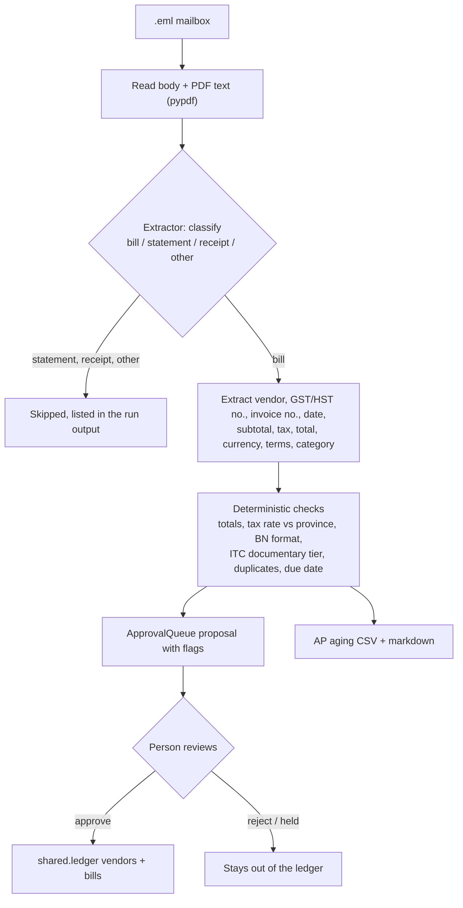

# 02_bills: accounts payable intake

Supplier invoices arrive in a shared finance mailbox mixed in with statements, payment receipts, newsletters and resends. Someone has to pick out the real bills, key them in, check the tax, decide whether the GST/HST can be claimed as an input tax credit (ITC), spot duplicates, and work out what is due when. This module does the reading and checking, then stops at an approval queue. A person decides what reaches the ledger.

## Run it

```bash
uv run python 02_bills/run.py                     # dry run: proposals + AP aging, no ledger writes
uv run python 02_bills/run.py --approve           # approve or reject each bill at the prompt
uv run python 02_bills/run.py --auto-approve      # demo: clean bills approved, flagged bills held
AFO_LLM_MODE=live ANTHROPIC_API_KEY=... uv run python 02_bills/run.py   # Claude reads the mail
uv run python 02_bills/bills_data.py              # regenerate the synthetic mailbox (seed 42)
uv run python evals/eval_bills.py                 # accuracy against the labelled set
```

Outputs go to `out/bills/`: `ap_aging.csv`, `ap_aging.md`, `proposals.json`, and `ledger.db` once something is approved. `--as-of` defaults to the date stored with the synthetic set (2026-11-03) so the buckets come out the same on every run.

## Workflow



## What is automated and what a person approves

| Step | Who | How |
|---|---|---|
| Classify each email | Extractor | `RulesExtractor` (regex) by default; `ClaudeExtractor` with `--extractor claude` or when `AFO_LLM_MODE` is `live`/`record` |
| Read bill fields | Extractor | Same; Claude is called through `shared.llm.extract` with a schema-checked tool call |
| Suggest an expense account | Extractor | Keyword map (rules) or a constrained enum (Claude), from an 11-line chart of accounts in `bills_extract.py` |
| Totals, tax rate, GST/HST number, ITC tier, duplicates, due date, bucket | Code | `bills.py`, all tested |
| Post a bill to the ledger | **Person** | `--approve` asks y/N per bill. `--auto-approve` approves only bills with no flags and holds the rest |
| Pay a bill | Not done | Out of scope; the aging report shows what is due |

Flags raised for a person:

- `duplicate`: same vendor and invoice number as an earlier email or a bill already in the ledger (vendor names compared without case, punctuation or Inc./Ltd.)
- `possible duplicate`: similar vendor name, total within 1% and invoice dates within 7 days, under a different number
- `total mismatch`: subtotal + GST/HST + PST/QST differs from the printed total by more than one cent
- `tax rate inconsistent with vendor address`: the GST/HST charged matches neither the vendor's province rate nor the recipient's province rate (see limitations)
- `missing GST/HST registration number` on a bill of $100 or more that charges tax
- GST/HST number not in the form 9 digits + `RT` + 4 digits, or failing the business-number check digit
- `foreign currency`
- `missing fields` when the vendor, invoice number, date or total could not be read

## Input tax credit rules applied

An ITC can only be claimed if the registrant holds documents with the information prescribed by the Input Tax Credit Information (GST/HST) Regulations, s. 3, under subsection 169(4) of the Excise Tax Act. The information required depends on the total paid or payable on the document:

| Total | Information required (cumulative) |
|---|---|
| under $100 | supplier name, invoice date, total amount |
| $100 to $499.99 | plus the supplier's GST/HST registration number and the tax amount (or a statement that tax is included and the rate) |
| $500 or more | plus the recipient's name, the terms of payment, and a description of each supply |

The module also:

- treats an ITC as not applicable when no GST/HST was charged;
- holds the ITC (`needs_review`, $0) when the tax rate or total is inconsistent, since tax charged in error is not tax payable;
- counts 50% of the tax on meals and entertainment, per ETA s. 236;
- refuses an ITC on a foreign-currency invoice until it is converted to CAD;
- never treats PST, RST or QST as an ITC (QST has its own input tax refund system, not modelled here).

It assumes every purchase is used 100% in commercial activities.

## Regulatory references

- Input Tax Credit Information (GST/HST) Regulations, SOR/91-45, s. 3: https://laws-lois.justice.gc.ca/eng/regulations/SOR-91-45/section-3.html
- CRA, GST/HST Memorandum 8.4, *Documentary Requirements for Claiming Input Tax Credits*: https://www.canada.ca/en/revenue-agency/services/forms-publications/publications/8-4/documentary-requirements-claiming-input-tax-credits.html. The memorandum dates from 2012 and still shows the old $30 and $150 thresholds. The regulations were amended in 2021 to $100 and $500, and those are the thresholds used here.
- GST/HST rates by province (in `shared/tax.py`): https://www.canada.ca/en/revenue-agency/services/tax/businesses/topics/gst-hst-businesses/charge-collect-which-rate/calculator.html
- Excise Tax Act, s. 169 (ITCs) and s. 236 (meals and entertainment): https://laws-lois.justice.gc.ca/eng/acts/E-15/

## Synthetic data

`bills_data.py` (Faker `en_CA`, seed 42) writes 36 `.eml` messages to `data/synthetic/bills/inbox/` and their ground truth to `labels.json`. The output is byte-identical between runs: the PDF writer runs in invariant mode and the MIME boundary is pinned. All names, addresses and GST/HST numbers are invented, and every email domain ends in `.test`.

- **Templated (30):** PDF invoices in three layouts, invoices pasted into the email body, three statements, three receipts, five marketing or internal emails, and these planted cases: a resent duplicate, a re-issue under a new number, a Nova Scotia vendor charging 15%, a $508.50 contractor bill with no registration number, a US vendor billing in USD with no GST, a printed total that is $10 too high, a malformed registration number, a meals bill, a BC bill with PST and a 2/10 Net 30 bill.
- **Holdout (6):** formats the rules baseline was not written for: a prose invoice with the vendor only in the signature, a quote-style table PDF, a Quebec invoice with French labels (TPS/TVQ), a card-charge receipt that mentions an invoice, an account summary that never says "statement", and a forwarded invoice.

## Eval

`evals/eval_bills.py` scores email classification and ten extracted fields (vendor, GST/HST number, invoice number, date, subtotal, tax, total, currency, terms, category), split into templated and holdout. Terms are compared by meaning: `Net 14` and "due within 14 days" count as equal. The eval also scores flag precision and recall against the planted cases. Claude is scored only in `live` or `record` mode. No recorded Claude responses are committed, so CI scores the rules baseline only.

RulesExtractor results on this data (from `uv run python evals/eval_bills.py`):

| Split | Messages | Classification accuracy | Bills | Mean field accuracy |
|---|---|---|---|---|
| templated | 30 | 1.00 | 19 | 1.00 |
| holdout | 6 | 0.50 | 4 | 0.40 |
| all | 36 | 0.917 | 23 | 0.896 |

Flags across all 36 messages: 7 true positives, 0 missed, 8 false positives. All 8 are `missing fields` or `total mismatch` flags on four holdout messages the rules misread, two of which are not bills at all. These flags are what keeps such a message out of auto-approval.

The templated score is high because the regexes were written against those three layouts, so it says little about real mail. The holdout split is the honest number for the baseline, and it is the gap the Claude extractor is meant to close. Run the eval in `record` mode to measure Claude.

## Limitations

- The tax-rate check accepts either the vendor's province rate or the recipient's. Real place-of-supply rules (ETA Schedule IX) depend on what was supplied and where it was delivered, so a correct rate can still be flagged, and an incorrect rate that happens to match the vendor's province can pass. A Quebec supplier charging GST + QST to an Ontario customer passes the check for this reason.
- The check-digit test on the business number is a typo screen, not a registry lookup. Confirm numbers in the CRA GST/HST Registry before claiming large ITCs.
- No foreign-exchange conversion. USD bills are reported in their own currency and held.
- Text is read from the PDF text layer only. Scanned image PDFs would need OCR.
- `shared.ledger.bills` has no currency, total or PST column, so a posted bill keeps its subtotal and GST/HST but loses PST/QST and currency. The full payload is kept in `proposals.json`.
- The rules baseline has known bugs that are left in place so the holdout score stays honest. For example, its fallback terms regex reads "HST 13% on net 162.50" as "net 162". Those bills are flagged `missing fields` and held.
- Duplicate detection only compares against this run and bills already in the ledger, not paid history.
