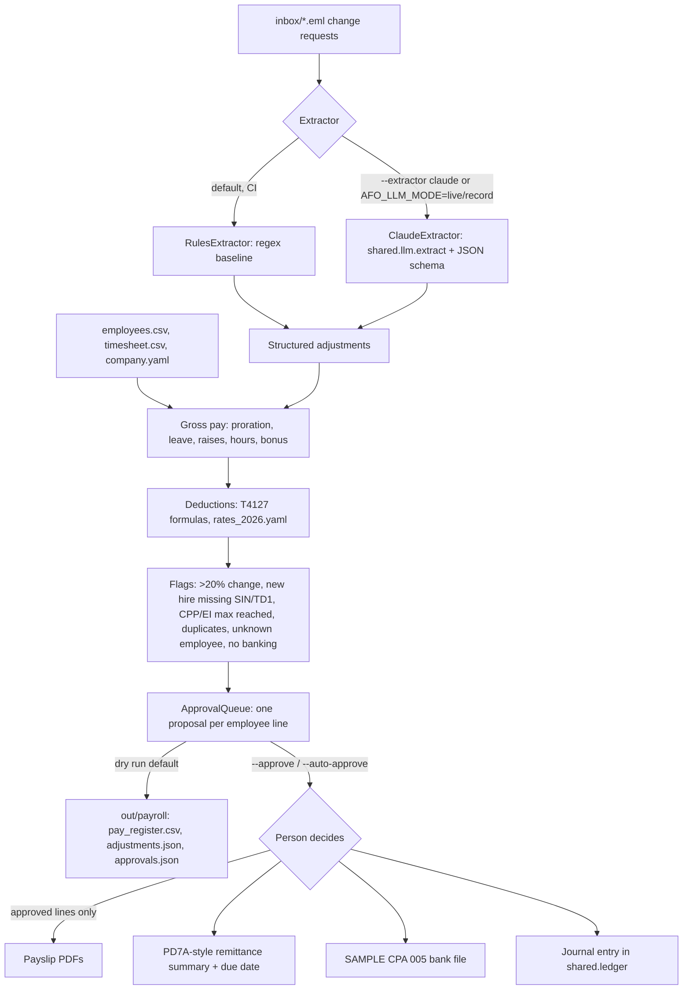

# 03 Payroll: semi-monthly pay run for a small Ontario employer

## The job

Each pay period someone has to collect what changed (a raise, unpaid days, a new hire, a bonus, a timesheet fix), work out gross pay, take off CPP, CPP2, EI and income tax, get sign-off, then produce payslips, the CRA remittance, the bank deposit file and the journal entry. This module does that for a synthetic employer with nine employees, paid semi-monthly (24 periods a year), for the period 1 to 15 November 2026, pay date 13 November 2026.

The roster covers the cases that usually need care:

| ID | Pay | What it exercises |
|----|-----|-------------------|
| E01 | Salary $72,000 | Raise to $78,000 effective 1 Nov (read from email) |
| E02 | Salary $145,000 | Already over the CPP, CPP2 and EI maximums: no CPP/EI deducted |
| E03 | Salary $85,000 | Reaches the CPP maximum this period (flagged) |
| E04 | Salary $80,000 | 2 days unpaid leave (exactly -20%, below the flag threshold); reaches the EI maximum (flagged) |
| E05 | Salary $68,000 | TD1 claim above the basic amount (federal $31,000, Ontario $23,000) |
| E06 | Salary $95,000 | $1,500 bonus, taxed by the bonus method; request arrives twice (flagged) |
| E07 | Hourly $31.00 | 6 hours added back from last period |
| E08 | Hourly $24.50 | 4 overtime hours at 1.5x |
| E09 | Salary $62,000 | New hire starting 9 Nov, prorated; SIN and TD1 not received (flagged) |

## Workflow



## Automated vs. approved by a person

Automated:
- Reading the change-request emails into structured adjustments (the only model step).
- Gross pay: salary split by working day (so mid-period raises and start dates prorate), unpaid leave, hours and overtime, bonus.
- CPP, CPP2, EI (employee and employer) and federal and Ontario income tax, all in plain `Decimal` code.
- Flags, reconciliation checks (PD7A total equals the sum of lines; bank file total equals net pay; journal balances to zero).

Decided by a person:
- Every pay line goes to `shared.approvals.ApprovalQueue`. Nothing is written, paid or posted until it is approved.
- `run.py` is a dry run by default. `--approve` asks y/n per line. `--auto-approve` is for demos and holds every flagged line.
- Adjustments that cannot be matched to an employee (for example a new hire who has not been set up) become flagged `pay_exception` items instead of being guessed.
- Uploading the bank file and paying the CRA stay manual. The bank file is marked SAMPLE and uses file creation number `TEST`.

## Running it

```bash
uv run python 03_payroll/payroll_data.py           # regenerate the synthetic data (seed 42)
uv run python 03_payroll/run.py                    # dry run
uv run python 03_payroll/run.py --auto-approve     # demo: 5 lines approved, 4 flagged lines held
uv run python 03_payroll/run.py --approve          # review each line
AFO_LLM_MODE=live ANTHROPIC_API_KEY=... uv run python 03_payroll/run.py --extractor claude
uv run python evals/eval_payroll.py                # extraction accuracy
```

## How the deductions are calculated

`payroll_calc.py` follows the CRA's *T4127 Payroll Deductions Formulas* and names its variables after the T4127 glossary.

- **CPP**: `C = min(4,230.45 x PM/12 - D, 0.0595 x (PI - 3,500/P))`. The per-period basic exemption is truncated to the cent, as in T4127 table 6.1 (3,500/24 = 145.83).
- **CPP2**: `C2 = min(416 x PM/12 - D2, (PIYTD + PI - W) x 0.04)`, `W = max(PIYTD, YMPE)`.
- **EI**: `min(1,123.07 - D1, 0.0163 x IE)`; employer share is 1.4 x the employee premium.
- **Annual taxable income**: `A = P x (I - F5A)`, where `F5 = C x 0.0100/0.0595 + C2` is the deduction for the enhanced CPP part.
- **Federal**: `T1 = R x A - K - K1 - K2 - K4` with the 2026 lowest rate of 14%, the income-tested basic personal amount (BPAF, $16,452 reducing to $14,829), the CPP base and EI credit (K2) and the Canada employment amount (K4, $1,501).
- **Ontario**: `T4 = V x A - KP - K1P - K2P`, plus surtax `V1` (20% over $5,818, 36% over $7,446), minus the Ontario tax reduction `S` ($300 basic), plus the Ontario Health Premium `V2`.
- **Per period**: `(T1 + T2) / P`, rounded to the cent (half up).
- **Bonus**: the T4127 difference method. Tax on the bonus is the annual tax with the bonus minus the annual tax without it. In the with-bonus step, the CPP base and EI on the bonus are added to the K2/K2P credit, as in the T4127 example.

Remittance amount = employee CPP + CPP2 + employer CPP + CPP2 + employee EI + employer EI + income tax. Due date for a regular remitter is the 15th of the month after the pay date (15 December 2026 here). If that falls on a weekend, payment received the next business day is on time.

Year-to-date amounts for periods 1 to 20 are produced by running the same engine at each employee's pre-change rate, so they are consistent with this period's maths.

**Check results against the CRA Payroll Deductions Online Calculator (PDOC):**
https://www.canada.ca/en/revenue-agency/services/e-services/e-services-businesses/payroll-deductions-online-calculator.html.
The unit tests assert two employees against values worked by hand from the T4127 formulas (written out in `test_payroll_calc.py`), but they were not compared with PDOC output when this module was written.

## Rates and regulatory references

All rates are in `rates_2026.yaml`. They come from the 2026 T4127 (123rd edition, effective 1 July 2026, the edition in force for a November pay run) and its CSV tables. The July edition changed British Columbia, Newfoundland and Labrador and Prince Edward Island only. Federal and Ontario values are the same as in January 2026.

- T4127 Payroll Deductions Formulas (index): https://www.canada.ca/en/revenue-agency/services/forms-publications/payroll/t4127-payroll-deductions-formulas.html
- T4127, July 2026 edition: https://www.canada.ca/en/revenue-agency/services/forms-publications/payroll/t4127-payroll-deductions-formulas/t4127-jul.html
- T4127, January 2026 edition, full formulas: https://www.canada.ca/en/revenue-agency/services/forms-publications/payroll/t4127-payroll-deductions-formulas/t4127-jan/t4127-jan-payroll-deductions-formulas-computer-programs.html
- CPP rates, maximums and exemptions: https://www.canada.ca/en/revenue-agency/services/tax/businesses/topics/payroll/payroll-deductions-contributions/canada-pension-plan-cpp/cpp-contribution-rates-maximums-exemptions.html
- EI premium rates and maximums: https://www.canada.ca/en/revenue-agency/services/tax/businesses/topics/payroll/payroll-deductions-contributions/employment-insurance-ei/ei-premium-rates-maximums.html
- Remittance due dates: https://www.canada.ca/en/revenue-agency/services/tax/businesses/topics/payroll/remitting-source-deductions/how-when-remit-due-dates.html
- CPA Standard 005 (Payments Canada): https://www.payments.ca/. The record layout used here (1464-byte A/C/Z records) follows Canadian banks' published CPA 005 credit-file specifications. Confirm it against your own bank's specification.

Key 2026 values: YMPE $74,600; YAMPE $85,000; CPP 5.95%, max $4,230.45; CPP2 4%, max $416.00; EI 1.63%, maximum insurable earnings $68,900, max premium $1,123.07 (employer $1,572.30); federal brackets 14% / 20.5% / 26% / 29% / 33% at $58,523 / $117,045 / $181,440 / $258,482; Ontario 5.05% / 9.15% / 11.16% / 12.16% / 13.16% at $53,891 / $107,785 / $150,000 / $220,000; Ontario basic personal amount $12,989.

## Extraction eval

`evals/eval_payroll.py` scores the extractor on 21 hand-labelled emails: the 6 in this period's inbox and 15 more in `data/synthetic/payroll/eval/`. They include cancelled requests, questions that need no change, percentage raises, several changes in one email and number words. The labels are in `labels.json` and were written alongside the data, not by a model.

RulesExtractor, as committed:

| Metric | Value |
|---|---|
| Emails | 21 (20 labelled adjustments) |
| Email exact match | 0.667 |
| Adjustment precision | 1.000 |
| Adjustment recall | 0.750 |
| Adjustment F1 | 0.857 |
| Field accuracy on matched adjustments | 0.975 |

The rules baseline misses percentage raises, "moves to $33 an hour", "Wednesday to Friday", hours to remove, and a second change in the same sentence. The ClaudeExtractor has not been scored, because no API key was available when this module was built and no recorded responses are committed. Run the eval with `AFO_LLM_MODE=record` to score it and save fixtures to `03_payroll/fixtures/`.

## Limitations

- Ontario only, outside Quebec. Employees aged 18 to 70, contributing CPP for all 12 months (PM = 12). There is no CPP-exempt or EI-exempt handling and no CPT30 election.
- No RPP, RRSP, union dues, taxable benefits, vacation pay accrual, statutory holiday pay or ESA overtime rules beyond the hours given (overtime is 1.5x on the hours in the timesheet).
- Bonus tax uses the difference method only. It does not use the flat-rate option for small bonuses, and the K2 treatment on bonuses is an approximation of PDOC.
- Working-day proration for salaried staff. Some employers prorate by calendar days or hours.
- CRA public holidays are not modelled in the remittance due date; only weekends are.
- The CPA 005 file is a sample: one payment per C record, a synthetic originator ID, and institution number 999. Banks differ on details such as unused segments and the processing centre code.
- The PD7A output is a summary for review. It is not the CRA form.
- Synthetic SINs start with 0, a prefix that is not used for real SINs. Banking details are fictitious.
