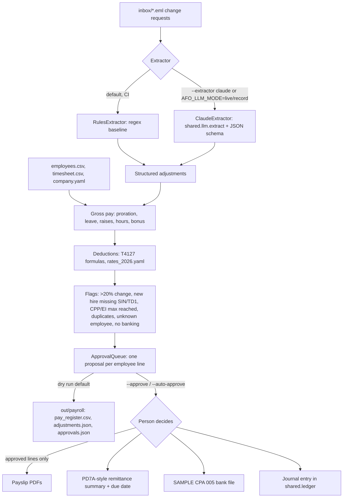

# 03 Payroll: semi-monthly pay runs for a small Ontario or Montreal employer, plus year-end slips and the ROE

## The job

Each pay period someone has to collect what changed (a raise, unpaid days, a new hire, a bonus, a timesheet fix), work out gross pay, take off CPP, CPP2, EI and income tax, get sign-off, then produce payslips, the CRA remittance, the bank deposit file and the journal entry. This module does that for a synthetic employer with nine employees, paid semi-monthly (24 periods a year), for the period 1 to 15 November 2026, pay date 13 November 2026.

It also runs the same job for a synthetic Montreal employer (six employees, [below](#quebec-employees-montreal-employer)), where the deductions are QPP and QPP2, QPIP, EI at the Quebec rate, federal tax less the 16.5% Quebec abatement and Quebec income tax, and two remittances are due: one to the CRA and one to Revenu Québec. At year end it builds T4 slips and the T4 Summary, RL-1 slips for Quebec employees, a SAMPLE T4 XML file, HTML and PDF summaries, and Record of Employment data for an employee who was laid off ([year-end](#year-end-t4-rl-1-and-the-roe)).

The roster covers the cases that usually need care:

| ID | Pay | What it exercises |
|----|-----|-------------------|
| E01 | Salary $72,000 | Raise to $78,000 effective 1 Nov (read from email) |
| E02 | Salary $145,000 | Already over the CPP, CPP2 and EI maximums: no CPP/EI deducted |
| E03 | Salary $85,000 | Reaches the CPP maximum this period (flagged) |
| E04 | Salary $80,000 | 2 days unpaid leave (exactly -20%, below the flag threshold); reaches the EI maximum (flagged) |
| E05 | Salary $68,000 | TD1 claim above the basic amount (federal $31,000, Ontario $23,000) |
| E06 | Salary $95,000 | $1,500 bonus, taxed by the bonus method; request arrives twice (flagged) |
| E07 | Hourly $31.00 | 6 hours added back from last period |
| E08 | Hourly $24.50 | 4 overtime hours at 1.5x |
| E09 | Salary $62,000 | New hire starting 9 Nov, prorated; SIN and TD1 not received (flagged) |

## Workflow



## Automated vs. approved by a person

Automated:
- Reading the change-request emails into structured adjustments (the only model step).
- Gross pay: salary split by working day (so mid-period raises and start dates prorate), unpaid leave, hours and overtime, bonus.
- CPP, CPP2, EI (employee and employer) and federal and Ontario income tax, all in plain `Decimal` code.
- Flags, reconciliation checks (PD7A total equals the sum of lines; bank file total equals net pay; journal balances to zero).

Decided by a person:
- Every pay line goes to `shared.approvals.ApprovalQueue`. Nothing is written, paid or posted until it is approved.
- `run.py` is a dry run by default. `--approve` asks y/n per line. `--auto-approve` is for demos and holds every flagged line.
- Adjustments that cannot be matched to an employee (for example a new hire who has not been set up) become flagged `pay_exception` items instead of being guessed.
- Uploading the bank file and paying the CRA stay manual. The bank file is marked SAMPLE and uses file creation number `TEST`.

## Running it

```bash
uv run python 03_payroll/payroll_data.py           # regenerate the synthetic data (seed 42)
uv run python 03_payroll/run.py                    # dry run
uv run python 03_payroll/run.py --auto-approve     # demo: 5 lines approved, 4 flagged lines held
uv run python 03_payroll/run.py --approve          # review each line
AFO_LLM_MODE=live ANTHROPIC_API_KEY=... uv run python 03_payroll/run.py --extractor claude
uv run python evals/eval_payroll.py                # extraction accuracy, deduction cases, year-end checks

# Montreal employer
uv run python 03_payroll/payroll_data_qc.py        # regenerate the Quebec synthetic data (seed 42)
uv run python 03_payroll/run.py --data data/synthetic/payroll_qc --out out/payroll_qc
uv run python 03_payroll/payroll_yearend.py --data data/synthetic/payroll_qc   # T4, RL-1, T4 XML, ROE
uv run python 03_payroll/payroll_yearend.py                                    # Ontario employer: T4 only
```

## How the deductions are calculated

`payroll_calc.py` follows the CRA's *T4127 Payroll Deductions Formulas* and names its variables after the T4127 glossary.

- **CPP**: `C = min(4,230.45 x PM/12 - D, 0.0595 x (PI - 3,500/P))`. The per-period basic exemption is truncated to the cent, as in T4127 table 6.1 (3,500/24 = 145.83).
- **CPP2**: `C2 = min(416 x PM/12 - D2, (PIYTD + PI - W) x 0.04)`, `W = max(PIYTD, YMPE)`.
- **EI**: `min(1,123.07 - D1, 0.0163 x IE)`; employer share is 1.4 x the employee premium.
- **Annual taxable income**: `A = P x (I - F5A)`, where `F5 = C x 0.0100/0.0595 + C2` is the deduction for the enhanced CPP part.
- **Federal**: `T1 = R x A - K - K1 - K2 - K4` with the 2026 lowest rate of 14%, the income-tested basic personal amount (BPAF, $16,452 reducing to $14,829), the CPP base and EI credit (K2) and the Canada employment amount (K4, $1,501).
- **Ontario**: `T4 = V x A - KP - K1P - K2P`, plus surtax `V1` (20% over $5,818, 36% over $7,446), minus the Ontario tax reduction `S` ($300 basic), plus the Ontario Health Premium `V2`.
- **Per period**: `(T1 + T2) / P`, rounded to the cent (half up).
- **Bonus**: the T4127 difference method. Tax on the bonus is the annual tax with the bonus minus the annual tax without it. In the with-bonus step, the CPP base and EI on the bonus are added to the K2/K2P credit, as in the T4127 example.

Remittance amount = employee CPP + CPP2 + employer CPP + CPP2 + employee EI + employer EI + income tax. Due date for a regular remitter is the 15th of the month after the pay date (15 December 2026 here). If that falls on a weekend, payment received the next business day is on time.

Year-to-date amounts for periods 1 to 20 are produced by running the same engine at each employee's pre-change rate, so they are consistent with this period's maths.

## PDOC check

Checked on 3 November 2026 against the CRA Payroll Deductions Online Calculator (PDOC, https://apps.cra-arc.gc.ca/ebci/rhpd/beta/entry, page version 2026-10-28), for the two employees worked by hand in `test_payroll_calc.py`. PDOC inputs: salary calculation, Ontario, semi-monthly (24 periods), paid 2026-11-13, no year-to-date amounts, 12 pensionable months, employer EI rate 1.4. PDOC was driven with a headless browser; the figures below were copied from its results page.

**Case 1:** $72,000/yr ($3,000.00 per period), TD1 federal $16,452.00, TD1 Ontario $12,989.00 (basic amounts).

| | CPP | CPP2 | EI | Federal tax | Provincial tax | Total tax |
|---|---|---|---|---|---|---|
| PDOC | 169.82 | 0.00 | 48.90 | 319.59 | 167.98 | 487.57 |
| `payroll_calc.compute` | 169.82 | 0.00 | 48.90 | 319.59 | 167.98 | 487.57 |

**Case 2:** $68,000/yr ($2,833.33 per period), TD1 federal $31,000.00, TD1 Ontario $23,000.00.

| | CPP | CPP2 | EI | Federal tax | Provincial tax | Total tax |
|---|---|---|---|---|---|---|
| PDOC | 159.91 | 0.00 | 46.18 | 202.14 | 132.26 | 334.40 |
| `payroll_calc.compute` | 159.91 | 0.00 | 46.18 | 202.14 | 132.26 | 334.40 |

Every figure matches to the cent, and PDOC's "deductions for CPP additional contribution" (28.54 and 26.88) match the module's F5 (28.5412 and 26.8756, rounded). This covers a regular salary period with no year-to-date amounts. It does not cover bonuses, the CPP/EI maximum being reached mid-period, or CPP2, which this run did not trigger. Those paths are tested against hand calculations only.

## Rates and regulatory references

All rates are in `rates_2026.yaml`. They come from the 2026 T4127 (123rd edition, effective 1 July 2026, the edition in force for a November pay run) and its CSV tables. The July edition changed British Columbia, Newfoundland and Labrador and Prince Edward Island only. Federal and Ontario values are the same as in January 2026.

- T4127 Payroll Deductions Formulas (index): https://www.canada.ca/en/revenue-agency/services/forms-publications/payroll/t4127-payroll-deductions-formulas.html
- T4127, July 2026 edition: https://www.canada.ca/en/revenue-agency/services/forms-publications/payroll/t4127-payroll-deductions-formulas/t4127-jul.html
- T4127, January 2026 edition, full formulas: https://www.canada.ca/en/revenue-agency/services/forms-publications/payroll/t4127-payroll-deductions-formulas/t4127-jan/t4127-jan-payroll-deductions-formulas-computer-programs.html
- CPP rates, maximums and exemptions: https://www.canada.ca/en/revenue-agency/services/tax/businesses/topics/payroll/payroll-deductions-contributions/canada-pension-plan-cpp/cpp-contribution-rates-maximums-exemptions.html
- EI premium rates and maximums: https://www.canada.ca/en/revenue-agency/services/tax/businesses/topics/payroll/payroll-deductions-contributions/employment-insurance-ei/ei-premium-rates-maximums.html
- Remittance due dates: https://www.canada.ca/en/revenue-agency/services/tax/businesses/topics/payroll/remitting-source-deductions/how-when-remit-due-dates.html
- CPA Standard 005 (Payments Canada): https://www.payments.ca/. The record layout used here (1464-byte A/C/Z records) follows Canadian banks' published CPA 005 credit-file specifications. Confirm it against your own bank's specification.

Key 2026 values: YMPE $74,600; YAMPE $85,000; CPP 5.95%, max $4,230.45; CPP2 4%, max $416.00; EI 1.63%, maximum insurable earnings $68,900, max premium $1,123.07 (employer $1,572.30); federal brackets 14% / 20.5% / 26% / 29% / 33% at $58,523 / $117,045 / $181,440 / $258,482; Ontario 5.05% / 9.15% / 11.16% / 12.16% / 13.16% at $53,891 / $107,785 / $150,000 / $220,000; Ontario basic personal amount $12,989.

Quebec rates are in `rates_2026_qc.yaml`, each with its source:

- Revenu Québec, TP-1015.F-V (2026-01), Formulas to Calculate Source Deductions and Contributions: https://www.revenuquebec.ca/documents/en/formulaires/tp/TP-1015.F-V%282026-01%29.pdf (publication page: https://www.revenuquebec.ca/en/online-services/forms-and-publications/current-details/tp-1015-f-v/)
- CRA T4127 January 2026 (122nd edition), Quebec lines in chapter 4 and tables 8.3 to 8.8: https://www.canada.ca/en/revenue-agency/services/forms-publications/payroll/t4127-payroll-deductions-formulas/t4127-jan/t4127-jan-payroll-deductions-formulas-computer-programs.html, with the CSVs https://www.canada.ca/content/dam/cra-arc/formspubs/pub/t4127-jan/cpp-qpp-ttl-01-26e.csv and https://www.canada.ca/content/dam/cra-arc/formspubs/pub/t4127-jan/ei-01-26e.csv
- Quebec abatement 0.165 in the July 2026 table 8.2: https://www.canada.ca/content/dam/cra-arc/formspubs/pub/t4127-jul/other-rates-amounts-26e.csv
- Year-end: CRA RC4120 (Rev. 25) https://www.canada.ca/en/revenue-agency/services/forms-publications/publications/rc4120/employers-guide-filing-t4-slip-summary.html; T4 XML specification https://www.canada.ca/en/revenue-agency/services/e-services/filing-information-returns-electronically-t4-t5-other-types-returns-overview/t619-2026/t4-2026.html; T619 https://www.canada.ca/en/revenue-agency/services/e-services/filing-information-returns-electronically-t4-t5-other-types-returns-overview/t619-2026.html; RL-1 box B.B, Revenu Québec lines 98 and 98.2 https://www.revenuquebec.ca/fr/citoyens/declaration-de-revenus/produire-votre-declaration-de-revenus/comment-remplir-votre-declaration-de-revenus/aide-par-ligne/96-a-164-revenu-total/lignes-98-et-98-2/; ROE guide https://www.canada.ca/en/employment-social-development/programs/ei/ei-list/reports/roe-guide.html

Key 2026 Quebec values: QPP 6.30% (base 5.30% + first additional 1.00%), max $4,479.30 (base-only $3,768.30); QPP2 4% up to $85,000, max $416; QPIP 0.430% employee / 0.602% employer on up to $103,000, max $442.90 / $620.06; EI 1.30%, max $895.70 (employer $1,253.98); federal abatement 16.5%; Quebec tax 14% / 19% / 24% / 25.75% over $54,345 / $108,680 / $132,245; basic personal amount $18,952; deduction for workers 6% up to $1,450; health services fund 1.65% (payroll of $1 million or less).

## Quebec employees (Montreal employer)

`data/synthetic/payroll_qc/` is a synthetic Montreal employer (Atelier Exemple Montréal Inc.) paying the same period. Province of employment comes from `company.yaml` (`province: QC`) or an employee's `province` column, so one employer can have staff in both provinces.

| ID | Pay | What it exercises |
|----|-----|-------------------|
| Q01 | Salary $72,000 | Basic TD1 and TP-1015.3-V claims; the hand-checked case below |
| Q02 | Salary $120,000 | Already over QPP, QPP2 and EI maximums; reaches the QPIP maximum this period (flagged) |
| Q03 | Salary $88,000 | Reaches the QPP maximum this period (flagged) and starts paying QPP2 |
| Q04 | Hourly $29.00 | 6 overtime hours; raise to $30.50 from 9 Nov, read from email (mid-period split) |
| Q05 | Salary $65,000 | TD1 federal $20,000 and TP-1015.3-V $22,000; $2,000 bonus (Quebec method 2) |
| Q06 | Hourly $26.50 | Started 12 Jan 2026, laid off 23 Oct 2026: not in this run; used for the ROE |

```text
$ uv run python 03_payroll/run.py --data data/synthetic/payroll_qc --out out/payroll_qc
Pay run 2026-11-01..2026-11-15, pay date 2026-11-13  (extractor: rules)
2 adjustments read from 2 emails

ID   Employee                  Gross    QPP+2      EI   QPIP       Tax        Net  Flags
----------------------------------------------------------------------------------------
Q01  Monique Lefebvre       3,000.00   179.81   39.00  12.90    594.63   2,173.66  
Q02  Benjamin Cormier       5,000.00     0.00    0.00  12.90  1,374.92   3,612.18  reaches QPIP annual maximum this period (QPIP 12.90)
Q03  Théodore Bolduc        3,666.67   139.10    0.00  15.77    826.05   2,685.75  reaches QPP annual maximum this period (QPP 43.10)
Q04  Philippe Martel        2,654.50   158.05   34.51  11.41    473.73   1,976.80  
Q05  Zoé Lapointe           4,708.33   287.44   61.21  20.25  1,156.17   3,183.26  gross changes +74% vs normal period pay 2708.33 (threshold 20%)
----------------------------------------------------------------------------------------
     TOTAL                 19,029.50   764.40  134.72  73.23  4,425.50  13,631.65
Remittances if all lines approved: CRA $2,345.02 (federal tax, EI); Revenu Québec $4,422.33 (QPP, QPIP, Quebec tax, health services fund)
```

### How the Quebec deductions are calculated

Federal parts follow the "Only for employees in Quebec" lines of T4127 chapter 4; Quebec parts follow Revenu Québec's *TP-1015.F-V, Formulas to Calculate Source Deductions and Contributions* (2026-01). Code: `payroll_calc.compute_qc` and the functions above it.

- **QPP**: `C = min(4,479.30 x PM/12 - A5, 0.0630 x (S3 - 3,500/P))`, the per-period exemption truncated to the cent. **QPP2**: `C2 = min(416 x PM/12 - A8, 0.04 x (S5 + S3 - W))`, `W = max(S5, 74,600)`. Results above 0 but under one cent are withheld as $0.01, as the guide requires.
- **QPIP**: employee `min(442.90 - A6, 0.00430 x S4)`, employer `min(620.06 - A7, 0.00602 x S4)`.
- **EI**: 1.30%, maximum $895.70 on $68,900; employer 1.4x.
- **Federal tax**: `A = P x (I - F5A)` with `F5Q = C x 0.0100/0.0630 + C2`; `T3 = R x A - K - K1 - K2Q - K4`, where `K2Q = 0.14 x [min(P x C x 0.0530/0.0630, 3,768.30) + min(P x EI, 895.70) + min(P x IE x 0.0043, 442.90)]`; `T1 = T3 - 0.165 x T3`. Bonus: the same T4127 difference method used for Ontario.
- **Quebec tax, regular pay**: `I = P x (G - F - H - CSA) - J - J1`, `H = min(0.06 x G, 1,450/P)` (deduction for workers), `CSA = (C x 0.01/0.0630 + C2) x (S3 - B2)/S3`; `Y = T x I - K - K1 - 0.14 x E - 0.15 x P x Q - 0.15 x P x Q1` on the 2026 table (14% / 19% / 24% / 25.75% over $54,345 / $108,680 / $132,245; constants 2,717 / 8,151 / 10,465); `E` = TP-1015.3-V amount, $18,952 if no form; tax per period `Y/P + L`. H and CSA are rounded to the cent, as in the guide's appendix 1.
- **Quebec tax, bonuses**: method 2, `A = T x (B2 - CSB)` at the marginal rate of `I = P x (G - F - H - CSA) + B1 + B2 - CSB1 - CSB - J - J1`; 7% flat if annual pay plus the lump sum is $18,952 or less.
- **Health services fund** (employer only): 1.65% of Quebec wages, the rate for total payroll of $1 million or less outside the primary, manufacturing and public sectors.
- **Remittances**: federal tax and EI (employee and employer) go to the CRA on the PD7A; QPP, QPP2, QPIP (both shares), Quebec tax and the health services fund go to Revenu Québec (`rq_remittance_summary.txt`). The Revenu Québec due date is deliberately not computed (see [unverified](#what-was-not-verified)).

### Quebec check

Not compared with WebRAS or PDOC. Revenu Québec's WebRAS page returned HTTP 403 to the automated fetch, and PDOC is a JavaScript application that a plain web fetch cannot drive (it returns only "Loading/Chargement"). PDOC also does not calculate Quebec provincial tax. The Quebec figures were checked two other ways instead, both in `test_payroll_quebec.py`:

**1. Revenu Québec's own worked examples (TP-1015.F-V 2026-01, appendices 1 to 3), reproduced to the cent.**

| Example | Guide | `payroll_calc` |
|---|---|---|
| App. 1, $4,000 biweekly, RPP $200, E $21,830, FTQ/Fondaction shares: periods 1-18 tax | 444.51 | 444.51 |
| App. 1, periods 20-21 / 22 / last 4 | 421.46 / 481.76 / 489.36 | 421.46 / 481.76 / 489.36 |
| App. 2, retroactive pay $4,000 (method 2): CSB, I, tax | 39.51, 74,140.09, 676.49 | 39.51, 74,140.09, 676.49 |
| App. 3, QPP / QPP2 in periods 19, 20, 22 | 95.94 + 56.00, 0 + 160.00, 0 + 40.00 | same |

Appendix 1's 19th period was not used: the guide shows CSA = 71.24, but 95.94 x 0.01/0.0630 + 56 = 71.23, so the guide's own figure appears to be off by a cent there.

**2. One employee worked by hand from the formulas** ($72,000 a year, semi-monthly, basic claims, no year-to-date; full working in the test docstring):

| | QPP | QPP2 | EI | QPIP | Federal tax | Quebec tax | Net |
|---|---|---|---|---|---|---|---|
| By hand | 179.81 | 0.00 | 39.00 | 12.90 | 265.29 | 329.34 | 2,173.66 |
| `payroll_calc.compute` | 179.81 | 0.00 | 39.00 | 12.90 | 265.29 | 329.34 | 2,173.66 |

The hand calculation and the code use the same reading of the formulas, so a shared misreading would not show up; the Revenu Québec examples are the independent check on the Quebec-tax and QPP formulas. The federal Quebec part (K2Q, abatement) has only the hand check.

## Year-end: T4, RL-1 and the ROE

`payroll_yearend.py` builds the slips from pay runs, not from a separate calculation. `payroll_history.replay_year` runs `build_pay_run` for all 24 periods of 2026: periods 1-20 at each employee's pre-change pay (hourly hours from `hours_history.csv`, or 80 hours), period 21 is the real run with this period's emails, and periods 22-24 are **projected** with no further changes. Year-to-date amounts are accumulated from the lines, and a test checks that the replay reproduces every year-to-date column in both `employees.csv` files to the cent. All lines are treated as approved and paid.

```text
$ uv run python 03_payroll/payroll_yearend.py --data data/synthetic/payroll_qc
Year-end 2026 for Atelier Exemple Montréal Inc. (SAMPLE - synthetic data - NOT FOR FILING)
24 pay runs replayed; projected periods: [22, 23, 24]
T4 slips: 6  line 14 441,285.75  line 80 53,221.90  line 82 53,221.79  difference 0.11
RL-1 slips: 6  box A 441,285.75  due to Revenu Québec 109,539.16  remitted 109,539.16
ROE: Julie Cloutier reason A, 15A 1384 h, 15B 24340.25
Outputs in out/payroll_yearend/payroll_qc/ (T4 XML: SAMPLE_NOT_FOR_FILING_t4.xml)
```

Outputs in `out/payroll_yearend/<dataset>/`: `t4_slips.json`, `t4_summary.json`, `SAMPLE_NOT_FOR_FILING_t4.xml`, `rl1_slips.json` and `rl1_totals.json` (Quebec only), `SAMPLE_roe_<name>.json` and `_15C.csv`, `yearend_summary.html` and `yearend_summary.pdf`.

- **T4 slips** (CRA RC4120, Rev. 25): box 14, 16/16A or 17/17A, 18, 22, 24 (capped at $68,900), 26 (capped at the YAMPE, $85,000), 28, 45, and 55/56 for Quebec (56 capped at $103,000). Box 22 is federal tax only for a Quebec employee. A missing SIN is written as `000000000`, as the spec requires, and flagged.
- **T4 Summary**: lines 14, 16, 16A, 18, 19, 22, 27, 27A, 80, 82, 84/86, 88. Line 19 is 1.4 x line 18 as RC4120 says; the pay runs remitted 1.4 x EI rounded each period, so line 80 differs from the remittances on line 82 by $0.11 (Montreal) and $0.09 (Ontario). The CRA generally does not charge or refund $2 or less. QPP never appears on the T4 Summary.
- **T4 XML**: T619 transmittal plus one T4 return, with element names and order from the CRA's 2026 T619 and T4 XML specifications. It starts with an XML comment saying SAMPLE / NOT FOR FILING, uses submission reference `SAMPLE01`, and every account number and SIN is synthetic. On 3 Nov 2026 both generated files (Ontario and Montreal) were validated against `T619_T4.xsd` from the CRA's schema package `xmlschm1-27-1` (the final 2027 package, for returns filed in 2027) with `uv run --with lxml python 03_payroll/validate_t4_xml.py <schema folder> <file>`: both valid. A file with a bad report-type code was rejected, which shows the check works. The schema is not committed and the check is not part of CI. Schema-valid does not mean the CRA would accept a filing.
- **RL-1** (Quebec employees): A, B.A (QPP base + first additional), B.B (QPP2, line 98.2 per Revenu Québec), C, E (Quebec tax), G (capped at $74,600, or $85,000 when B.B has an amount), H, I (capped at $103,000), plus totals that reconcile to the year's Revenu Québec remittances to the cent. JSON only; no RL XML (Revenu Québec's format was not attempted).
- **ROE data** (Service Canada ROE guide, electronic ROE, semi-monthly): block 15A insurable hours over the last 25 periods, 15B insurable earnings over the last 13, 15C earnings and hours by period with P.P. 1 = the final period, block 16 reason A. Salaried hours are taken as 7.5 per paid day (an assumption; this case is hourly). Vacation pay owing on separation (block 17A) is not modelled and is flagged for a person.

## What was not verified

Parameters and rules that could not be confirmed from an official source, and are therefore not used to compute anything:

- **Revenu Québec remittance due dates.** The schedule page could not be read (HTTP 403 to automated requests). `rq_remittance_summary` leaves the due date empty and says so.
- **A mid-year (July 2026) edition of TP-1015.F-V.** Only the 2026-01 edition was read. The CRA's July 2026 T4127 lists no Quebec or federal change.
- **Vacation pay on separation** (Quebec labour standards) for the ROE: not modelled, flagged.

Everything in `rates_2026_qc.yaml` was read from TP-1015.F-V (2026-01) or the CRA T4127 2026 tables and is cited there. The 2026 QPP, QPIP and EI figures in the two sources agree.

## Extraction eval

`evals/eval_payroll.py` scores the extractor on 21 hand-labelled emails: the 6 in this period's inbox and 15 more in `data/synthetic/payroll/eval/`. They include cancelled requests, questions that need no change, percentage raises, several changes in one email and number words. The labels are in `labels.json` and were written alongside the data, not by a model.

RulesExtractor, as committed:

| Metric | Value |
|---|---|
| Emails | 21 (20 labelled adjustments) |
| Email exact match | 0.667 |
| Adjustment precision | 1.000 |
| Adjustment recall | 0.750 |
| Adjustment F1 | 0.857 |
| Field accuracy on matched adjustments | 0.975 |

The rules baseline misses percentage raises, "moves to $33 an hour", "Wednesday to Friday", hours to remove, and a second change in the same sentence. The ClaudeExtractor has not been scored, because no API key was available when this module was built and no recorded responses are committed. Run the eval with `AFO_LLM_MODE=record` to score it and save fixtures to `03_payroll/fixtures/`.

The same eval also reports (`evals/results.json`, computed 3 Nov 2026):

| Check | Result |
|---|---|
| Montreal inbox, 2 labelled emails (rules) | 2 of 2 exact. Both are phrased like the Ontario templates the rules were written for, so this says nothing about harder phrasing |
| Deductions against external figures (`evals/payroll_deduction_cases.json`: 2 PDOC cases, 1 Quebec hand calculation, 9 Revenu Québec worked-example cases) | 12 of 12 cases, 37 of 37 fields to the cent. These figures are also unit tests, so this is a regression check, not a held-out score |
| Year-end reconciliation, Ontario (24 runs, 9 T4 slips) | 3 of 3 checks; T4 line 80 minus line 82 = $0.09 |
| Year-end reconciliation, Montreal (24 runs, 6 T4, 6 RL-1, 1 ROE) | 6 of 6 checks; T4 line 80 minus line 82 = $0.11; RL-1 totals equal Revenu Québec remittances |

## Limitations

- Ontario and Quebec only. Employees aged 18 to 70, contributing CPP or QPP for all 12 months (PM = 12). There is no CPP/QPP-exempt, EI-exempt or QPIP-exempt handling, no CPT30 election, and no transfer between a CPP and a QPP establishment during the year (T4127's K2R/K2RQ and the QPP transfer formulas are not implemented).
- Quebec: no CNESST, labour-standards (CNT) or workforce-skills (WSDRF) employer contributions; the health services fund rate assumes total payroll of $1 million or less outside the primary, manufacturing and public sectors. No Quebec tips, no TP-1016-V reductions (J1, K1 are supported by the function but always zero in runs), no labour-sponsored fund deductions in runs.
- Year-end: periods 22-24 are projections, and every line is treated as approved and paid. One T4 per employee (no mid-year province change). The RL-1 is JSON data, not Revenu Québec's XML or the RLZ-1.S summary form. The ROE is data for ROE Web, not a submission; vacation pay owing on separation is not modelled.
- No RPP, RRSP, union dues, taxable benefits, vacation pay accrual, statutory holiday pay or ESA overtime rules beyond the hours given (overtime is 1.5x on the hours in the timesheet).
- Bonus tax uses the difference method only. It does not use the flat-rate option for small bonuses, and the K2 treatment on bonuses is an approximation of PDOC.
- Working-day proration for salaried staff. Some employers prorate by calendar days or hours.
- CRA public holidays are not modelled in the remittance due date; only weekends are.
- The CPA 005 file is a sample: one payment per C record, a synthetic originator ID, and institution number 999. Banks differ on details such as unused segments and the processing centre code.
- The PD7A and Revenu Québec outputs are summaries for review. They are not the CRA or Revenu Québec forms.
- Synthetic SINs start with 0, a prefix that is not used for real SINs. Banking details are fictitious.
