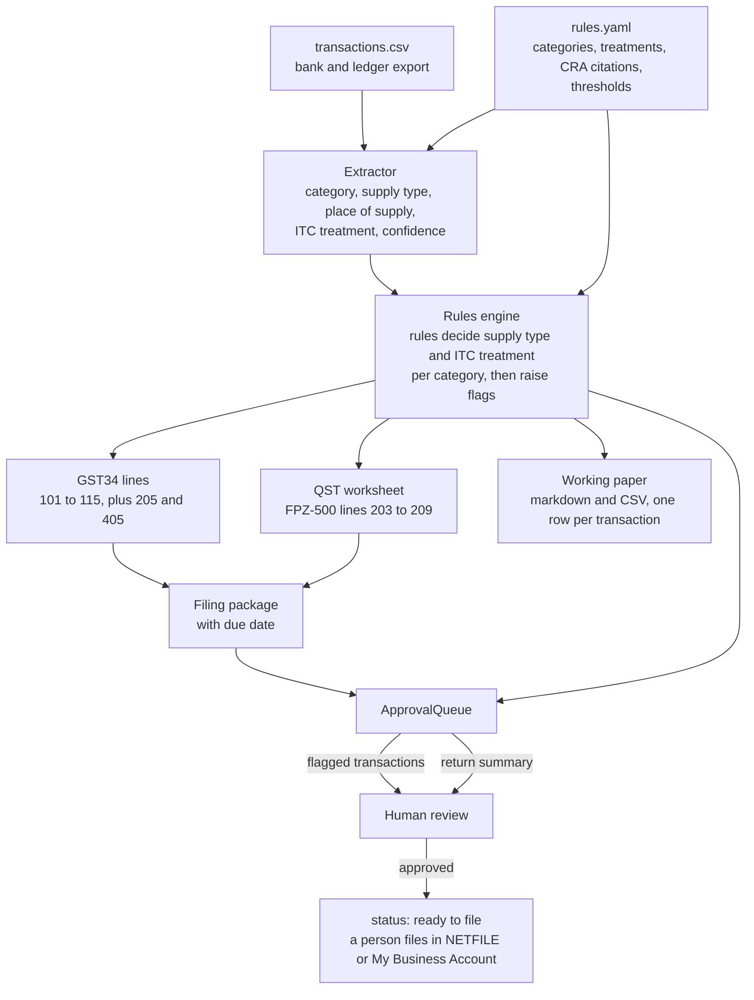

# 04 GST/HST and QST returns

Prepares the quarterly GST/HST return (form GST34) for a small Ontario-registered business that uses the regular method, not the Quick Method. The business is also registered for the Quebec sales tax, so the agent prepares a QST worksheet alongside it: the QST lines of Revenu Québec's return (FPZ-500), including input tax refunds (ITRs) on QST paid to Quebec suppliers. The agent takes one quarter of the bank and ledger export, works out the tax treatment of each line, computes the return, and writes a working paper that traces every transaction to the line it feeds. It stops at a "ready to file" package. It does not file, pay or contact the CRA.

The sample business, Northlake Advisory Inc., is synthetic. It sells consulting services to customers in Ontario, Alberta, British Columbia, Quebec and the US, and rents out one long-term residential unit. Its fiscal year ends January 31, so the sample quarter is August 1 to October 31, 2026 (127 transactions).

## Workflow



1. `rules.yaml` is written once. It lists twelve categories (domestic sale, export, exempt residential rent, credit note, general purchase, meals and entertainment, personal, insurance, bank fees, foreign digital service, capital asset, out-of-scope transfer). Each category has a supply type (taxable, zero-rated, exempt, out of scope), an ITC treatment (full, 50%, none, not applicable), the GST34 lines it feeds, any flag it always raises, and its CRA or statute citation.
2. The extractor reads each free-text description and picks a category, a place of supply and a confidence.
3. The engine looks the category up in the rules. If the extractor's supply type or ITC treatment disagrees with the rules, the rules value is used and the item is flagged.
4. Deterministic code computes the line contributions and the GST34 totals, in integer cents with half-up rounding.
5. The working paper (`out/gst_hst/working_paper.md` and `.csv`) lists the contributions to lines 101, 103, 106, 107 and 405 transaction by transaction, so the subtotals equal the return lines. It also lists every transaction that feeds no line, with the reason.
6. If `business.json` says `qst_registered`, the engine also works out the QST lines (see below) and writes `qst_worksheet.md` and `qst.json`, with the same transaction-level traces.
7. Each flagged transaction, the GST34 summary and the QST summary go to `shared.approvals.ApprovalQueue`.

## Automated vs. human

| Step | Who |
|---|---|
| Reading descriptions, choosing a category and place of supply | Extractor: rules baseline, or Claude via `shared.llm.extract` with a JSON schema |
| Supply type, ITC fraction, line mapping | `rules.yaml`, applied by code |
| Tax arithmetic, rounding, GST34 totals, due date | Code (`gst_hst.py`), covered by tests |
| Deciding flagged items (personal use, duplicates, missing BN, foreign vendor tax, etc.) | Human |
| QST collectible, ITRs, QST worksheet | Code (`gst_hst.compute_qst`), covered by tests |
| Approving each return as ready to file | Human |
| Filing and paying | Human, outside this tool |

`--auto-approve` is for demos. It approves only unflagged proposals. A return with any open flag is held, so on the sample data the return is never auto-approved.

## Flags

| Flag | Trigger |
|---|---|
| Low confidence | Extractor confidence below 0.75 |
| Rule conflict | Extractor's supply type or ITC treatment differs from the rules for its category, or the category's direction (money in or out) does not match the bank sign |
| Personal expense | Category `personal` |
| Missing supplier BN | ITC claimed on a purchase of $30 or more with no supplier registration number. Under SOR/91-45 s. 3 the number is legally required from $100; between $30 and $100 the flag says it is advisory |
| Malformed BN | Not 9 digits + `RT` + 4 digits |
| Large refund | Credit note or refund of $1,000 or more |
| Foreign digital service | Always. The reviewer checks whether the vendor charged GST/HST. Tax charged by a simplified-registration vendor is not claimable as an ITC (ETA s. 211.17); the fix is to give the vendor the BN and ask for a s. 232 refund |
| Rate mismatch | Sales tax differs from the place-of-supply rate, or purchase tax matches no Canadian rate |
| Totals mismatch | Net + tax differs from the bank amount |
| Duplicate | Same date, amount and description as an earlier row. The later copy is held out of the return until confirmed |
| Capital asset | Confirm more than 50% commercial use, and record for CCA |
| Tax on exempt | Tax shown on a supply the rules treat as exempt or out of scope |
| Unknown place | Sale with no province or country; Ontario assumed |
| QST rate mismatch | QST on a Quebec sale, credit note or purchase differs from 9.975% of the net. On a sale billed without QST, the QST collectible is still reported |
| QST outside Quebec | QST shown on a sale whose place of supply is not Quebec |
| Missing QST number | ITR claimed on a purchase of $100 or more with no supplier QST number, or one not in the 10 digits + `TQ` + 4 digits form |

## Treatment choices

- **Line 101** includes zero-rated and exempt supplies (regular method). It is net of credit notes.
- **Line 103** uses tax collectible at the place-of-supply rate. If more was collected, the amount collected is used (ETA s. 225(1)), and the sale is flagged. The sample includes one Alberta invoice billed at 13%.
- **Credit notes**: the tax credited goes on line 107, as in Guide RC4022. The net reduces line 101.
- **Meals and entertainment**: 50% ITC is claimed as incurred, so line 104 has no year-end recapture.
- **Foreign digital services**: no ITC. No self-assessment on line 405 when the service is used 90% or more in commercial activities (`default_commercial_use_pct` in `rules.yaml`). Below that threshold, HST at the Ontario rate is self-assessed on line 405.
- **Due date**: one month after the period end (month end to month end). If that date falls on a weekend or a CRA-listed public holiday, the date is moved to the next business day.

## QST worksheet

The QST treatment of each category is in `rules.yaml` (`qst_itr_treatment` on every category, and a `qst` section with the rate, sources and return lines). For a QST registrant:

| Line | What goes on it |
|---|---|
| 203 | QST collectible: 9.975% of the net on taxable sales whose place of supply is Quebec. If more was collected, the amount collected (mirroring ETA s. 225(1)) |
| 204 | Amounts added to the QST collectible. Zero here |
| 205 | 203 + 204 |
| 206 | ITRs: QST paid on purchases, at the category's fraction (full for general purchases and capital assets, 50% for meals and entertainment, none for personal, exempt and out-of-scope items) |
| 207 | Amounts added to the ITRs: QST credited to Quebec customers on credit notes (as GST34 line 107) |
| 208 | 206 + 207 |
| 209 | QST net tax, 205 - 208; positive is owing to Revenu Québec |

Lines 203, 206 and 207 are described in Revenu Québec's FPZ-2034-G-V guide. Lines 204, 205, 208 and 209 are taken as the QST mirror of GST34 lines 104, 105, 108 and 109; revenuquebec.ca could not be fetched while this was built, so check them against the current form. The worksheet assumes the QST return is due on the same date as the GST/HST return, which is how a combined return works; confirm that too.

On the sample quarter the QST worksheet gives: collectible $1,541.14 (line 203), ITRs $205.44 (206), credit-note QST $79.80 (207), net QST owing $1,255.90 (209). One Quebec sale was billed with GST only; the $723.19 of QST it should have carried is still on line 203, and the sale is flagged.

## Run

```bash
uv run python 04_gst_hst/gst_hst_data.py          # regenerate the synthetic quarter (seed 42)
uv run python 04_gst_hst/run.py                   # dry run: outputs in out/gst_hst/, proposals pending
uv run python 04_gst_hst/run.py --approve         # y/n per proposal
uv run python 04_gst_hst/run.py --auto-approve    # demo
AFO_LLM_MODE=live ANTHROPIC_API_KEY=... uv run python 04_gst_hst/run.py   # Claude extractor
uv run python evals/eval_gst_hst.py
```

`--extractor claude` in replay mode needs recorded responses in `04_gst_hst/fixtures/`. None are committed, because no API key was available when the module was built. `AFO_LLM_MODE=record` creates them.

Outputs: `working_paper.md`, `working_paper.csv` (with QST columns and the QST line contributions), `gst34.json`, `qst_worksheet.md`, `qst.json`, `filing_package.md` (with a QST section), `approvals.json`, `status.json`.

## Eval

`evals/eval_gst_hst.py` scores the extractor against gold labels written by the generator. The eval set has 30 items, chosen by category, including the four with ambiguous descriptions. It also checks that the engine, given the gold labels, reproduces the generator's line totals. The generator computes those totals in its own code.

Rules extractor, on the current data:

| Measure | Eval set (30) | Full quarter (127) |
|---|---|---|
| Category | 28/30 (93.3%) | 125/127 (98.4%) |
| Supply type | 30/30 (100%) | 127/127 (100%) |
| ITC treatment | 28/30 (93.3%) | 125/127 (98.4%) |
| Place of supply (sales) | 8/9 (88.9%) | 45/47 (95.7%) |
| Errors that carry a review flag | 3/3 | 4/4 |

The nine Quebec rows were added with QST support from their own seeded random stream, generated after everything else, so the earlier rows, the 30-row eval set and its scores did not change. They are scored separately: category 9/9, place of supply 5/5 on the Quebec sales and the credit note.

- GST34 from the gold labels: all 18 lines match exactly.
- QST worksheet from the gold labels: all 7 lines match `expected_qst.json` exactly. The generator works those totals out in its own code.
- QST worksheet from the rules extractor: all 7 lines match.
- GST34 from the rules extractor: 10 of 18 lines match. The misses come from a card purchase coded only `SQ *JUNIPER`, which is labelled as a client lunch but classified as a general purchase, so it gets a full ITC instead of 50%; a marketplace order labelled personal that was given an ITC; and an Alberta deposit with no location, which the engine taxes at the Ontario rate. All three are flagged for review. The model has not been scored, because no API key was available.

The rules extractor is close to perfect because its keywords and the synthetic descriptions were written together. Its score says little about real bank data. Its job is to be a deterministic baseline, and to show that the flags catch what it gets wrong.

## References

- CRA, GST34 line-by-line instructions: https://www.canada.ca/en/revenue-agency/services/tax/businesses/topics/gst-hst-businesses/complete-file-instructions.html
- CRA Guide RC4022, General Information for GST/HST Registrants (credit notes on line 107, meals and entertainment, capital property, due dates): https://www.canada.ca/en/revenue-agency/services/forms-publications/publications/rc4022/general-information-gst-hst-registrants.html
- CRA, Type of supply: https://www.canada.ca/en/revenue-agency/services/tax/businesses/topics/gst-hst-businesses/charge-collect-type-supply.html
- CRA, Place of supply: https://www.canada.ca/en/revenue-agency/services/tax/businesses/topics/gst-hst-businesses/charge-collect-place-supply.html
- CRA GST/HST Memorandum 3-3, Place of Supply: https://www.canada.ca/en/revenue-agency/services/forms-publications/publications/3-3.html
- CRA, Input tax credits: https://www.canada.ca/en/revenue-agency/services/tax/businesses/topics/gst-hst-businesses/calculate-prepare-report/input-tax-credit.html
- Input Tax Credit Information (GST/HST) Regulations, SOR/91-45, s. 3: https://laws-lois.justice.gc.ca/eng/regulations/SOR-91-45/section-3.html
- Excise Tax Act (ss. 123, 144.1, 165, 169, 170, 199, 211.17, 217, 225, 232, 236, 238; Schedules V and VI): https://laws-lois.justice.gc.ca/eng/acts/E-15/
- CRA Notice 322, Recovery of the GST/HST under the digital economy measures: https://www.canada.ca/en/revenue-agency/services/forms-publications/publications/notice322/recovery-gst-hst-under-digital-economy-measures.html
- CRA, GST/HST for digital economy businesses: https://www.canada.ca/en/revenue-agency/services/tax/businesses/topics/gst-hst-businesses/digital-economy-gsthst.html
- CRA, Reporting requirements and deadlines: https://www.canada.ca/en/revenue-agency/services/tax/businesses/topics/gst-hst-businesses/file-gst-hst-return/reporting-requirements-deadlines.html
- CRA, Public holidays and due dates: https://www.canada.ca/en/revenue-agency/services/tax/public-holidays.html
- Revenu Québec, Calculating the Taxes (QST 9.975%): https://www.revenuquebec.ca/en/businesses/consumption-taxes/gsthst-and-qst/collecting-gst-and-qst/calculating-the-taxes/
- Revenu Québec, Input Tax Credits and Input Tax Refunds: https://www.revenuquebec.ca/en/businesses/consumption-taxes/gsthst-and-qst/itcs-and-itrs/
- Revenu Québec, Meal and Entertainment Expenses (ITCs and ITRs): https://www.revenuquebec.ca/en/businesses/consumption-taxes/gsthst-and-qst/special-cases-gsthst-and-qst/meal-and-entertainment-expenses-itcs-and-itrs/
- Revenu Québec, Preparing Invoices (supplier QST number from $100): https://www.revenuquebec.ca/en/businesses/consumption-taxes/gsthst-and-qst/collecting-gst-and-qst/preparing-invoices/
- Revenu Québec, FPZ-2034-G-V guide (QST lines 203, 206, 207): https://www.revenuquebec.ca/en/online-services/forms-and-publications/fpz-2034-g-v/guide-to-detailed-gst/hst-and-qst-calculations-and-the-return-respecting-taxable-real-property-immovables-taxable-carbon-emission-allowances-and-imported-taxable-supplies/

The full list, with the citation for each rule, is in `rules.yaml`. Check the citations against the current text before relying on them. This module is not tax advice.

## Limitations

- Services only. There are no rules for goods (delivery-based place of supply), imports of goods or real property (line 205).
- QST: no large-business ITR restrictions, no sales-based ceiling on meal ITRs, no QST self-assessment on imports, no instalments (line 210 onward), and Quebec place of supply follows the same recipient-address rule as the GST. Lines 204, 205, 208 and 209 are numbered by analogy with the GST34 (see above).
- Place of supply uses the general rule for services, based on the recipient's address. The other place-of-supply rules (for example, services tied to real property, or no address obtained) are not modelled. A sale with no location is taxed at the Ontario rate and flagged.
- Commercial-use percentage is a single default for each category. There is no apportionment for mixed-use property. There is also no restriction of ITCs on inputs used for the exempt residential rental.
- Meals ITCs are claimed at 50% as incurred. Long-haul trucker rates, and other exceptions to the 50% limit, are not handled.
- No instalments, rebates, bad-debt adjustments, change-in-use rules, or passenger-vehicle ITC limits.
- Holidays are the national CRA list (Quebec adds Saint-Jean-Baptiste Day). Provincial-only holidays are not included.
- Duplicate detection is an exact match on date, amount and description.
- Claude confidence scores are the model's own estimate and have not been calibrated.
