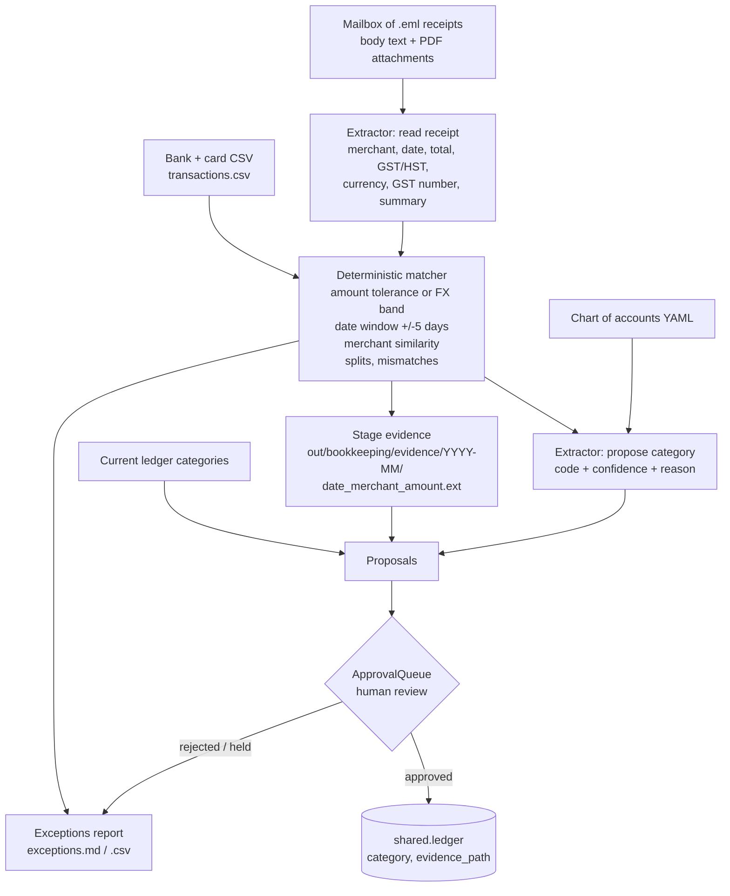

# 05 Bookkeeping: month-end records and evidence

The job: at month end, every bank and credit-card line should have the right account and a piece of evidence behind it (a receipt, an invoice, or a note that the statement itself is the record). In a small business this is usually an evening of searching the inbox, renaming PDFs and fixing categories someone guessed at during the month.

This module does the reading, matching and filing, and stops at an approval queue. Nothing reaches the ledger until a person approves it.

## Workflow



## What is automated and what a person approves

| Step | Who | Notes |
|---|---|---|
| Read each receipt email and attachment | Extractor (rules or Claude) | Structured fields only, via a forced JSON schema. |
| Match receipts to transactions | Plain code | `bookkeeping_match.py`. No model involved. |
| Propose an account for every transaction | Extractor | Proposed only when it differs from the current category and is not the suspense account. |
| Copy evidence into the filing structure | Plain code | Staged under `out/bookkeeping/evidence/`; harmless to re-run. |
| Link evidence to a ledger transaction | **Person** | `evidence_link` proposals. |
| Change a ledger category | **Person** | `recategorise` proposals, with the confidence and reason shown. |
| Chase missing receipts, decide on orphans | **Person** | From the exceptions report. |

`--auto-approve` exists for demos. It approves only proposals with no flags; anything flagged is held for a person. Flags raised:

- split payment (one invoice, several payments)
- amount mismatch (for example a tip added after the receipt was emailed)
- merchant name differs from the card descriptor (numbered companies), matched on exact amount only
- missing GST/HST registration number on a purchase of $100 or more
- possible duplicate charge
- low-confidence category (below 0.6)

The exceptions report also lists transactions with no evidence, receipts with no transaction, duplicate receipts, and documents that are not receipts (quotes, estimates). Lines where the statement is the record are listed separately: payouts, transfers, bank fees, remittances and draws.

## Running it

```bash
uv run python 05_bookkeeping/bookkeeping_data.py       # regenerate the synthetic month (seed 42)
uv run python 05_bookkeeping/run.py                    # dry run: proposals + exceptions, ledger untouched
uv run python 05_bookkeeping/run.py --approve          # y/N per proposal
uv run python 05_bookkeeping/run.py --auto-approve     # demo: unflagged approved, flagged held
AFO_LLM_MODE=live ANTHROPIC_API_KEY=... uv run python 05_bookkeeping/run.py   # Claude extractor
uv run python evals/eval_bookkeeping.py
uv run pytest -q 05_bookkeeping
```

Outputs go to `out/bookkeeping/`: `proposals.json`, `exceptions.md`, `exceptions.csv`, `receipts_extracted.json`, `matches.json`, `evidence/` and `ledger.db`. The ledger is rebuilt from the synthetic CSV on every run.

## Files

| File | Purpose |
|---|---|
| `bookkeeping_data.py` | Seeded generator (Faker `en_CA`, seed 42) for transactions, ledger categories, chart of accounts, mailbox and gold labels. |
| `bookkeeping_extract.py` | `Extractor` interface, `RulesExtractor` baseline, `ClaudeExtractor`, prompts and JSON schemas. |
| `bookkeeping_match.py` | Name normalisation, similarity, amount/FX/date rules, the matching passes. |
| `bookkeeping.py` | Pipeline, evidence filing, exceptions, proposals, ledger updates on approval. |
| `run.py` | CLI. |
| `test_bookkeeping.py` | Tests for the deterministic core and the generator. |

Data lives in `data/synthetic/bookkeeping/`. That covers 82 transactions over one bank account and one Visa card for October 2026, and 56 emails. The set includes a split payment, a USD card charge, a refund, a tip mismatch, a duplicate forwarded bill, a duplicate card charge, four receipts with no transaction (one is a French-language Quebec receipt) and one estimate. The current ledger has 23 lines in the wrong or suspense account. All merchants are invented and all domains end in `.test`.

## Model use

Two Extractor steps, each with a rules baseline and a Claude implementation:

- `read_receipt`: the schema is `RECEIPT_SCHEMA` and the system prompt is `RECEIPT_SYSTEM`. The prompt tells the model to copy numbers as printed and not compute them. It also says to keep GST/HST apart from PST/QST/MAT, to read Canadian DD/MM dates, to treat a processor named in the sender as something other than the merchant, to mark quotes as `is_receipt: false`, and never to invent a GST number.
- `categorise`: the schema is `CATEGORY_SCHEMA`. The system prompt holds the whole chart of accounts and is cached by `shared.llm`. Any code not in the chart is replaced with the suspense account and confidence 0.

Model output is never used for arithmetic. Amount tolerance, FX bands, date windows, split sums, the GST-number threshold and file names are all plain code with tests. No recorded Claude responses ship with this module. `--extractor claude` needs `AFO_LLM_MODE=live` or `record`. In `replay` mode with no fixtures it stops with a clear message. Recording writes fixtures to `05_bookkeeping/fixtures/`.

## Evaluation

`evals/eval_bookkeeping.py` scores against `labels.json`, which the generator writes. The RulesExtractor scores from the latest run are below.

| Metric | Result |
|---|---|
| Receipt fields, all correct (56 emails) | 0.982 |
| Match precision / recall (52 gold links) | 1.000 / 0.981 |
| Categorisation accuracy (82 transactions) | 0.939 |
| Lines wrong in the current ledger that the proposal fixes (23) | 0.957 |
| Current ledger accuracy, for comparison | 0.720 |
| Orphan receipt precision / recall | 0.800 / 1.000 |

Read these numbers with care. The rules baseline and the synthetic templates were written together, so the receipt-field scores show that the regexes cover these templates. They do not show how it would do on real receipts. The misses are the French receipt (comma decimals; the rules miss the total, so it shows as an orphan) and keyword gaps in categorisation. The ClaudeExtractor is scored only when `AFO_LLM_MODE` is `live` or `record`. No Claude numbers are reported here because no API key was used.

## Regulatory references

- CRA, *Keeping records*. Records must be organised, and paper or electronic formats are both covered: https://www.canada.ca/en/revenue-agency/services/tax/businesses/topics/keeping-records.html
- CRA, *Where to keep your records, for how long and how to request permission to destroy them early*. "Generally, you must keep all required records and supporting documents for a period of six years from the end of the last tax year they relate to": https://www.canada.ca/en/revenue-agency/services/tax/businesses/topics/keeping-records/where-keep-your-records-long-request-permission-destroy-them-early.html
- CRA, IC05-1R1 *Electronic Record Keeping*: https://www.canada.ca/en/revenue-agency/services/forms-publications/publications/ic05-1.html
- *Input Tax Credit Information (GST/HST) Regulations*, SOR/91-45, s. 3. The supplier's GST/HST registration number is required on supporting documents for purchases of $100 or more, and more detail is required at $500 or more: https://laws-lois.justice.gc.ca/eng/regulations/SOR-91-45/section-3.html

The evidence folder is organised by month so that it can be retained as a unit. This module does not enforce retention or deletion.

## Limitations

- It handles one month and one entity. It does not carry over receipts from the previous period. A September receipt shows as an orphan.
- The date window is ±5 days around the document date, or a printed debit date. Instalments are searched −5 to +30 days, and splits are capped at 3 payments.
- FX bands are fixed ranges per currency (USD 1.30–1.50 CAD), not a daily rate lookup. A charge in an unusual market could fall outside the band.
- The amount-only fallback links an unlike-named merchant only when exactly one transaction and one receipt fit within 2 days. It always flags the link.
- The rules categoriser uses keywords in the chart of accounts. It has no vendor memory and does not learn from approvals.
- Meals are not split into the 50% non-deductible portion here. That belongs to the year-end or GST/HST step.
- The ledger is the SQLite stand-in in `shared/ledger.py`. A real accounting platform would need an adapter.
- `shared.ledger` has no update helper, so `bookkeeping._update_txn` is a local one, limited to `category`, `evidence_path` and `tax_code`.
