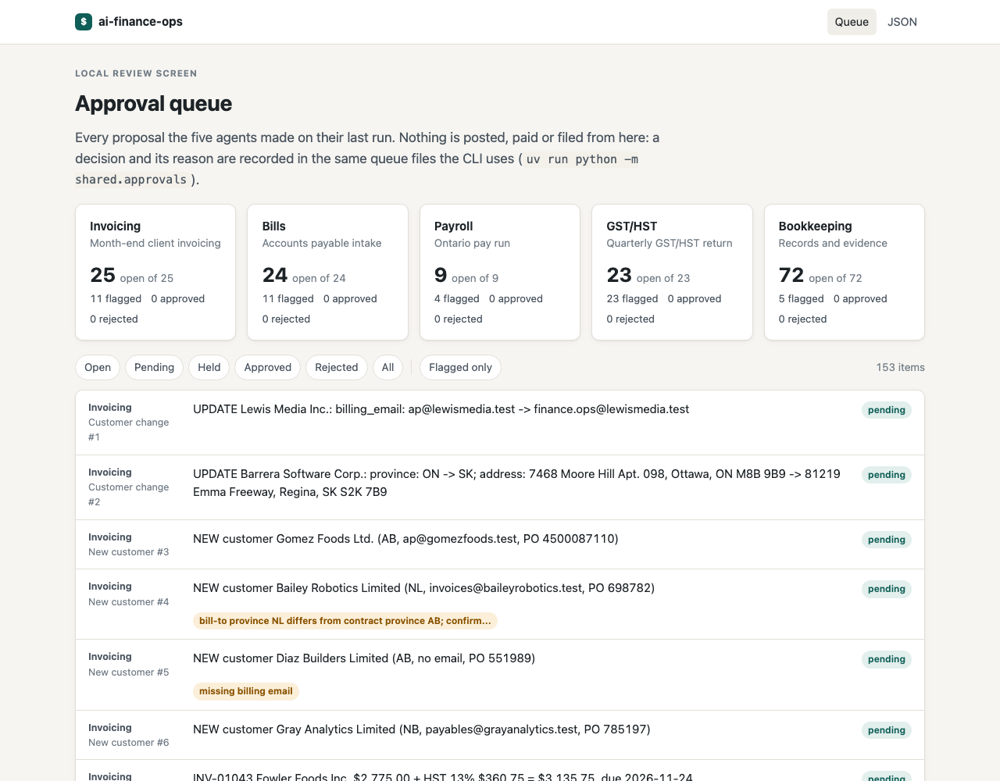
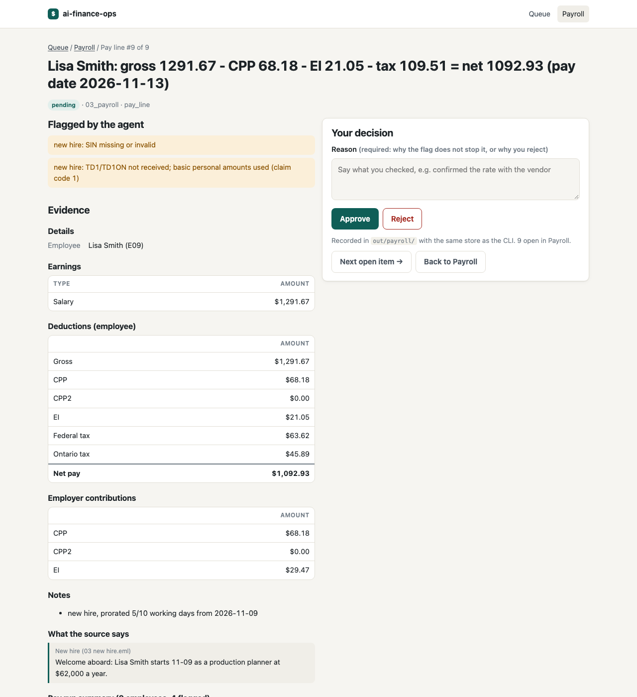
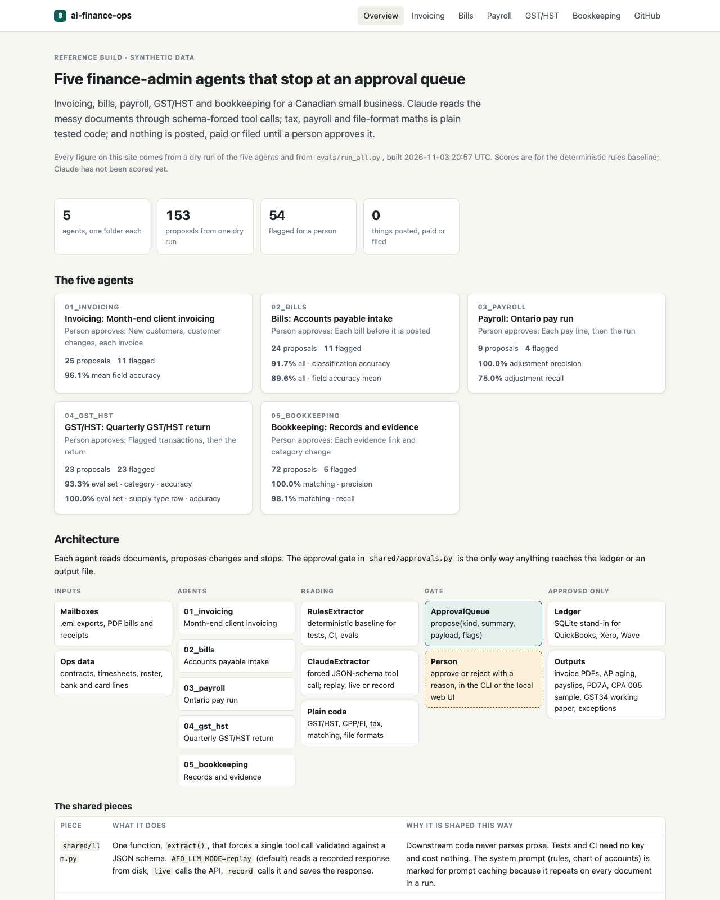
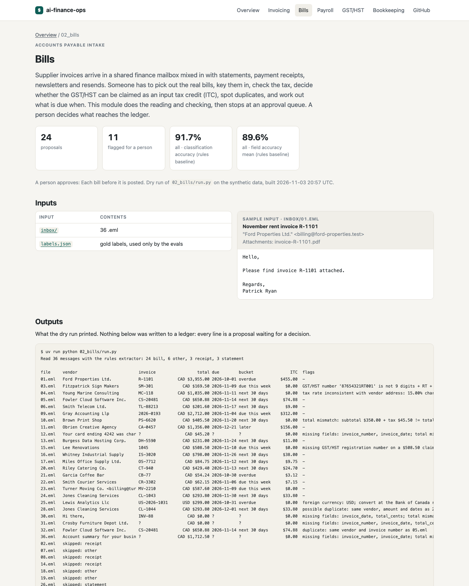
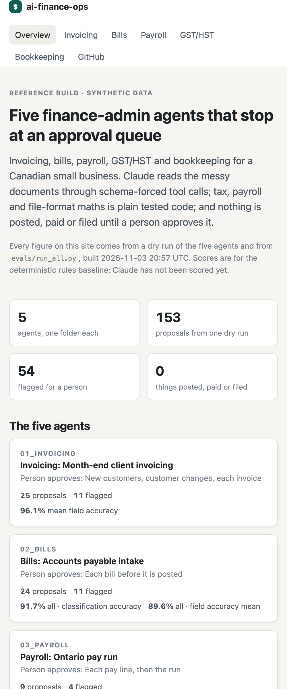

# ai-finance-ops

Five human-in-the-loop agents that do recurring finance admin for a Canadian small business: invoicing, bills, payroll, GST/HST and QST, and bookkeeping.

Claude extractors read the messy documents and answer through a JSON schema that is checked before any code uses the result; tax, payroll and file-format maths is plain tested code (payroll matches the CRA's PDOC calculator to the cent on both cases checked), and nothing is posted, paid or filed without a person's approval.

407 tests and labelled evals run in CI with no API key. The published scores are for a deterministic rules baseline: Claude has not been scored yet ([how to score it](#how-to-score-claude), one command).

Each agent takes a recurring back-office job, does the reading, matching and drafting, and stops at an approval queue so a person decides what is posted, paid or filed.

All data in this repository is synthetic. By default nothing connects to a real bank, the CRA, or an accounting platform: the ledger is SQLite and the mailbox is a folder of `.eml` files. Opt-in adapters for QuickBooks Online, Xero and IMAP/Gmail implement the same interfaces ([production boundaries](#production-boundaries)); they are unit-tested against schema-shaped mock responses and have not been run against a live account. This is a reference build, not a deployed product.

## The five agents

| Module | Recurring job | What the agent does | What a person approves |
|---|---|---|---|
| [01_invoicing](01_invoicing/) | Month-end client invoicing | Finds billable clients in the ops data, reads billing changes from email, builds lines (hourly, retainer, milestone), applies GST/HST by place of supply plus QST, PST or RST where the supplier is registered, renders invoice PDFs | New customers, customer changes, each invoice |
| [02_bills](02_bills/) | Accounts payable intake | Classifies a shared finance mailbox, extracts bills from PDFs and email bodies, checks totals, tax rates and GST/HST and QST numbers, records QST/PST/RST separately, decides ITC and QST input tax refund eligibility, detects duplicates, buckets by due date | Each bill before it is posted |
| [03_payroll](03_payroll/) | Ontario pay run | Reads pay-change emails, computes gross pay and CPP/CPP2, EI, federal and Ontario tax with the CRA T4127 formulas, produces payslips, PD7A remittance summary, a sample CPA 005 payment file and the journal | Each pay line, then the run |
| [04_gst_hst](04_gst_hst/) | Quarterly GST/HST and QST returns | Applies a cited rules file to every transaction, classifies supply type and ITC treatment, computes the GST34 lines and the QST worksheet (Revenu Quebec FPZ-500 lines 203 to 209, with input tax refunds) with transaction-level traces, computes the filing deadline | Flagged transactions, then each return |
| [05_bookkeeping](05_bookkeeping/) | Records and evidence | Reads receipts, matches them to bank and card lines (FX, splits, tips), proposes recategorisations, files evidence by period, reports exceptions | Each evidence link and category change |

## What a run looks like

`./scripts/demo.sh` dry-runs all five agents on the synthetic data in about five seconds and prints a summary of each. The excerpts below were copied from a real run of `uv run python 03_payroll/run.py` and `uv run python 02_bills/run.py` (rules extractor, no API key, 3 November 2026; the bills run was re-captured after QST/PST support was added). Every flag is something the agent will not decide on its own.

```text
$ uv run python 03_payroll/run.py
Pay run 2026-11-01..2026-11-15, pay date 2026-11-13  (extractor: rules)
6 adjustments read from 6 emails

ID   Employee                  Gross    CPP+2      EI       Tax        Net  Flags
---------------------------------------------------------------------------------
E01  Danielle Johnson       3,250.00   184.70   52.98    566.18   2,446.14  
E02  Joshua Walker          6,041.67     0.00    0.00  1,635.23   4,406.44  
E03  Jill Rhodes            3,541.67   189.45    0.00    661.34   2,690.88  reaches CPP annual maximum this period (CPP 189.45)
E04  Patricia Miller        2,666.67   149.99   36.47    394.84   2,085.37  reaches EI annual maximum this period (EI 36.47)
E05  Jeffery Wagner         2,833.33   159.91   46.18    334.40   2,292.84  
E06  Anthony Gonzalez       5,458.33   218.33    0.00  1,202.27   4,037.73  duplicate bonus request in 05_bonus_fwd.eml (same as 04_bonus.eml); counted once; gross changes +38% vs normal period pay 3958.33 (threshold 20%)
E07  Debra Gardner          2,666.00   149.95   43.46    393.31   2,079.28  
E08  Jeffrey Lawrence       2,009.00   110.86   32.75    242.05   1,623.34  
E09  Lisa Smith             1,291.67    68.18   21.05    109.51   1,092.93  new hire: SIN missing or invalid; new hire: TD1/TD1ON not received; basic personal amounts used (claim code 1)
---------------------------------------------------------------------------------
     TOTAL                 29,758.34 1,231.37  232.89  5,539.13  22,754.95
Remittance if all lines approved: $8,560.80

Dry run. Nothing paid, filed or posted. Proposals in out/payroll/
Re-run with --approve to review, or --auto-approve for a demo.
```

```text
$ uv run python 02_bills/run.py
Read 40 messages with the rules extractor: 28 bill, 6 other, 3 receipt, 3 statement

file     vendor                         invoice                 total due        bucket               ITC  flags
01.eml   Ford Properties Ltd.           R-1101          CAD $3,955.00 2026-10-01 overdue          $455.00  -
03.eml   Fitzpatrick Sign Makers        SM-301            CAD $169.50 2026-11-09 due this week      $0.00  GST/HST number '87654321RT001' is not 9 digits + RT + 4 digits
04.eml   Young Marine Consulting        MC-118          CAD $1,035.00 2026-11-11 next 30 days       $0.00  tax rate inconsistent with vendor address: 15.00% charged; expected NS 14% or ON 13%
05.eml   Fowler Cloud Software Inc.     CS-20481          CAD $650.88 2026-11-14 next 30 days      $74.88  -
...
10.eml   Brown Print Shop               PS-6620           CAD $405.50 2026-11-20 next 30 days       $0.00  total mismatch: subtotal $350.00 + tax $45.50 != total $405.50
25.eml   Lewis Analytics Llc            US-2026-1031      USD $299.00 2026-10-31 overdue            $0.00  foreign currency: USD; convert at the Bank of Canada rate before posting
28.eml   Jones Cleaning Services        CL-1044           CAD $293.80 2026-12-01 next 30 days      $33.80  possible duplicate: same vendor, amount and dates as 24.eml
32.eml   Fowler Cloud Software Inc.     CS-20481          CAD $650.88 2026-11-14 next 30 days      $74.88  duplicate: same vendor and invoice number as 05.eml
...
38.eml   Taylor Imprimerie Inc.         IM-0931           CAD $517.39 2026-11-28 next 30 days      $22.50  QST number '123456789TQ001' is not 10 digits + TQ + 4 digits
...

AP aging as of 2026-11-03 (exact duplicates excluded):
  CAD: overdue $4,009.24, due this week $4,039.75, next 30 days $6,943.25, later $1,356.00
  USD: overdue $299.00, due this week $0.00, next 30 days $0.00, later $0.00
Provincial tax on bills: PST $27.60, QST $194.52; QST input tax refunds claimable $134.67 (PST and RST are a cost)

28 bills proposed, 12 flagged for a person.
```

Architecture, with diagrams of `shared/`, the approval gate and the token log: [docs/architecture.md](docs/architecture.md).

## See it

**Local approval screen.** Dry-run the agents, then review every proposal from all five in one queue, with the evidence next to it: the invoice or bill PDF, the extracted bill fields, the agent's flags, the pay-run summary, the GST34 lines. Approve or reject with a reason. Decisions are written to the same queue files under `out/` that the CLI reads, so the two stay in sync. It binds to 127.0.0.1 and has no login, so keep it local.

```bash
./scripts/demo.sh                          # dry-run all five agents (writes out/)
uv run python -m webui                     # http://127.0.0.1:8700
uv run python -m webui --refresh           # or: dry-run first, then serve
uv run python -m shared.approvals          # the same queue from the terminal: counts per module
uv run python -m shared.approvals review 02_bills   # decide open bills at the prompt
```

Recording a decision does not post anything. The ledger, payment-file and filing steps still run only from each module's `run.py --approve`.

**Static demo site.** `uv run python scripts/build_site.py` dry-runs all five agents on the synthetic data, runs `evals/run_all.py`, and writes `site/`: an overview with the architecture, and one page per module showing its inputs, the run's output, the flags raised with their evidence, and the eval figures taken from the eval output. `.github/workflows/pages.yml` builds it and deploys it to GitHub Pages on every push to `main`; once Pages is enabled for the repository (Settings > Pages > Source: GitHub Actions) it is published at https://ankitmishra01.github.io/ai-finance-ops/.

| Approval queue | Evidence for a flagged pay line |
|---|---|
|  |  |

| Demo site overview | Module page (bills) | Phone width |
|---|---|---|
|  |  |  |

## Where things stand

Every model step has two implementations: a deterministic rules baseline, which runs in tests and CI, and a Claude extractor that answers through a schema-checked tool call. The numbers below are for the **rules baseline only**, computed by `evals/run_all.py` on synthetic labelled sets. Because the rules and the synthetic documents were written together, the scores on familiar formats are flattering; the held-out or unfamiliar-phrasing figures are the honest baseline that the Claude extractor is meant to beat. Claude has not been scored yet and no model responses have been recorded or invented; [one command](#how-to-score-claude) produces both.

| Module | Rules baseline, familiar formats | Rules baseline, harder cases | Tests |
|---|---|---|---|
| 01_invoicing | 94.1% mean field accuracy on customer details (37 cases) | 7 of 13 misses fall on 9 untuned phrasings and 5 on 3 Quebec-format cases (French address order, accented city); QST/PST charged only where the supplier is registered | 66 |
| 02_bills | 100% classification, 100% fields (34 templated emails) | 50% classification, 40% fields (6 held-out formats); provincial tax amount, kind and QST number read on 5 of 6 bills that carry it (the miss is the French TPS/TVQ invoice) | 77 |
| 03_payroll | Change-request extraction: precision 1.00, recall 0.75 (21 emails) | Deductions (CPP, CPP2, EI, federal and Ontario tax) match CRA PDOC to the cent for the 2 hand-checked employees ([PDOC check](03_payroll/README.md#pdoc-check), 3 Nov 2026) | 50 |
| 04_gst_hst | 93.3% category and ITC treatment (30 labelled); 9 of 9 Quebec rows | Gold labels reproduce all 18 GST34 lines and all 7 QST lines exactly; rules labels match 10 of 18 GST34 lines and 7 of 7 QST lines, every error flagged for review | 75 |
| 05_bookkeeping | Matching precision 1.00, recall 0.98; categorisation 93.9% (82 lines) | French receipt with comma decimals is missed and shows as an orphan | 50 |
| shared/ | Unit tests: ledger migrations and update whitelists, GST/HST and QST number validators, QST/PST/RST rates and rounding, MIME boundary, record/replay; QuickBooks, Xero and IMAP adapters against schema-shaped mocks; both Claude backends and the eval harness with fake clients | | 75 |
| webui/, scripts/build_site.py | Approval gate rules, web and CLI decisions on the same queue files, evidence pages, static site build | | 14 |
| **Total** | | | **407** |


## How to score Claude

One command scores every labelled set with the rules baseline and with Claude side by side, records each Claude response as a replayable fixture, writes the comparison to `evals/results/` and refreshes the table below. Nothing below has been run yet.

```bash
uv sync

# With an Anthropic API key (keep it out of the repo; .env is gitignored):
export ANTHROPIC_API_KEY=sk-ant-...
uv run python evals/run_all.py --extractor claude --record

# Or with a Claude subscription, through the locally installed, signed-in `claude` CLI (no API key):
uv run python evals/run_all.py --extractor claude-cli --record

# Another model (default: claude-sonnet-5-5, set in shared/pricing.yaml):
uv run python evals/run_all.py --extractor claude --record --model claude-opus-5-5

# One agent with Claude doing the reading:
AFO_LLM_MODE=live uv run python 02_bills/run.py --extractor claude
AFO_LLM_MODE=live AFO_LLM_BACKEND=cli uv run python 02_bills/run.py --extractor claude
```

What it writes:

- `evals/results/results.json`: every score, the run's settings (mode, backend, requested model, the model ids Claude reported) and the token cost by module.
- `evals/results/comparison.md` and the block below: per module, the headline metrics for rules and Claude, then tokens and USD per document processed. That is the token-analytics view of ROI: the cost of each automated document, to set against the time the same document takes by hand.
- `<module>/fixtures/*.json`: each response, keyed by prompt and schema, so CI can replay the run with no key. Fixtures recorded through the CLI replay exactly like API ones.

How the two backends differ:

- `--extractor claude` uses the Anthropic SDK. Cost per document is estimated from the token log at the first-party API rates in `shared/pricing.yaml`, which cites [Anthropic's pricing page](https://platform.claude.com/docs/en/about-claude/pricing); check it before quoting a figure.
- `--extractor claude-cli` runs `claude -p ... --output-format json` under a Claude subscription. Its scores are real model outputs, and the table names the exact model id the CLI reports. A subscription is not billed per token: the log records `subscription (no per-token billing)`, and shows an API-equivalent estimate only where the CLI reports token usage.

Both backends put the schema in front of Claude, check the answer against it, and retry once if it does not fit. Commit recorded fixtures only if they came from a real `record` run.

<!-- eval-table:start -->
_Generated by `evals/run_all.py` on 2026-11-03 16:02; extractor `rules`, mode `replay`._

| Module | Metric | Rules baseline | Claude |
|---|---|---|---|
| invoicing | Customer details: mean field accuracy | 96.1% | not run |
| invoicing | Customer details: all fields correct | 76.5% | not run |
| bills | Classification, templated | 100.0% | not run |
| bills | Field accuracy, templated | 100.0% | not run |
| bills | Classification, held-out formats | 50.0% | not run |
| bills | Field accuracy, held-out formats | 40.0% | not run |
| bills | Flag recall | 100.0% | not run |
| payroll | Change requests: precision | 100.0% | not run |
| payroll | Change requests: recall | 75.0% | not run |
| payroll | Change requests: field accuracy | 97.5% | not run |
| gst_hst | Category, eval set | 93.3% | not run |
| gst_hst | ITC treatment, eval set | 93.3% | not run |
| gst_hst | GST34 lines matching | 10 of 18 | not run |
| bookkeeping | Receipts: all fields correct | 98.2% | not run |
| bookkeeping | Matching precision | 100.0% | not run |
| bookkeeping | Matching recall | 98.1% | not run |
| bookkeeping | Categorisation accuracy | 93.9% | not run |

Claude has not been scored in this run. To score it: `uv run python evals/run_all.py --extractor claude --record` (API key) or `--extractor claude-cli --record` (local Claude Code subscription).
<!-- eval-table:end -->

## Design principles

- **Agents propose, people approve.** Every write goes through `shared/approvals.py`. Every `run.py` is a dry run unless told otherwise.
- **Deterministic where it can be, model where it must be.** Tax maths, payroll deductions and file formats are plain code with tests. Claude reads unstructured documents and classifies edge cases, always through a JSON schema checked in `shared/schema.py`.
- **Token analytics as the ROI ledger.** Every model call logs tokens, cache hits and estimated cost by run, module, task and document to `runs/token_log.jsonl`, and the eval harness reports tokens and USD per document, so the cost of each automation can be set against the hours it replaces.
- **Replayable.** `AFO_LLM_MODE=record` saves each Claude response next to its module (`<module>/fixtures/`) and `replay` serves them back, so a scored run can be reproduced offline. None are committed yet, because none have been recorded; tests and CI use the rules baseline and need no key.

## Run it

```bash
uv sync
uv run pytest -q                      # all tests, no API key needed
uv run python evals/run_all.py        # accuracy on labelled synthetic sets -> evals/results/
uv run python 01_invoicing/run.py     # dry run of one module
./scripts/demo.sh                     # dry run of all five, compact summary
AFO_LLM_MODE=live ANTHROPIC_API_KEY=... uv run python 02_bills/run.py
```

## Production boundaries

The agents talk to two interfaces in `shared/protocols.py`: `LedgerAdapter` and `Mailbox`. Defaults stay local; real adapters are opt-in through environment variables and read their credentials from the environment only.

| Setting | Default | Opt-in adapter | Credentials (env only) |
|---|---|---|---|
| `AFO_LEDGER` | `sqlite` (`shared/ledger.py`) | `quickbooks`: QuickBooks Online Accounting API v3 (`shared/adapters/quickbooks.py`) | `QBO_CLIENT_ID`, `QBO_CLIENT_SECRET`, `QBO_REFRESH_TOKEN`, `QBO_REALM_ID` |
| | | `xero`: Xero Accounting API (`shared/adapters/xero.py`) | `XERO_CLIENT_ID`, `XERO_CLIENT_SECRET`, `XERO_REFRESH_TOKEN`, `XERO_TENANT_ID` |
| `AFO_MAILBOX` | `eml` (`shared/mail.py`) | `imap`: Gmail or any IMAP server, read-only, stdlib `imaplib` (`shared/adapters/imap.py`) | `AFO_IMAP_USER` and `AFO_IMAP_PASSWORD` or `AFO_IMAP_OAUTH_TOKEN` |

Each adapter maps customers, invoices, bills and journal entries to the platform's documented endpoints, with citations in its docstring; uses OAuth2 refresh tokens, retries 429 and 5xx with Retry-After, and sends an idempotency key derived from the content (QuickBooks `requestid`, Xero `Idempotency-Key`) so a retried post cannot create a duplicate. The tests use hand-built mock responses shaped from the documented schemas, labelled as such in `tests/schema_mocks.py`; none were recorded from a real account. `02_bills` and `03_payroll` read through `get_mailbox()`, and `02_bills` posts approved bills through `get_ledger()`.

Security, PII, the audit log, idempotency, retries and how the approval gate maps to segregation of duties: [docs/production.md](docs/production.md).

## Credit

Inspired by Kieran Donnelly's post on the finance and admin automations he runs at Kwanda AI with Claude Code, rebuilt here for Canadian rules (GST/HST, QST, PST/RST, CPP/EI, PD7A, CPA-005).

## License

MIT
