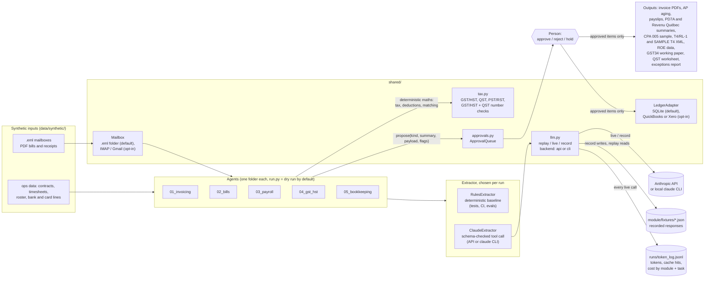
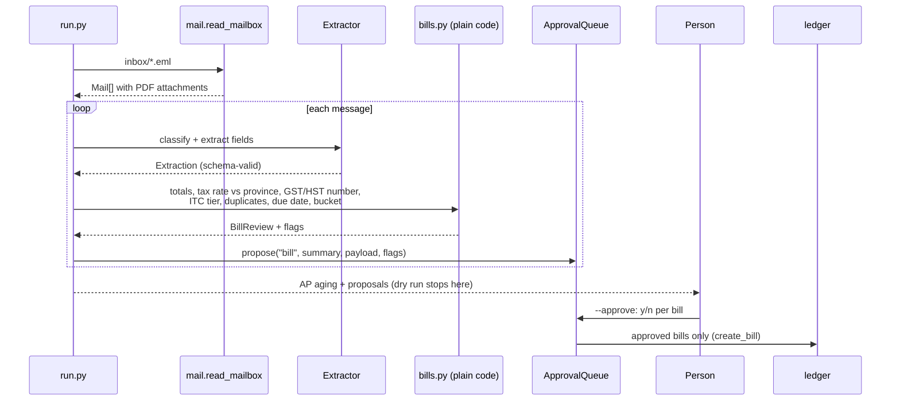

# Architecture

Five agents share one small library. Each agent reads documents, proposes changes, and stops. Nothing reaches the ledger, a payment file or a filing until a person approves it.

## The pieces

| Piece | What it does | Why it is shaped this way |
|---|---|---|
| `shared/llm.py` | One function, `extract()`, that asks for a single `submit` tool call (API) or a bare JSON object (`claude` CLI, `AFO_LLM_BACKEND=cli`), checks it against the JSON schema with `shared/schema.py`, and retries once if it does not fit. `AFO_LLM_MODE=replay` (default) reads a recorded response from disk, `live` calls Claude, `record` calls it and saves the response; fixtures from either backend replay the same way. | Downstream code never parses prose. Tests and CI need no key and cost nothing. The system prompt (rules, chart of accounts) is marked for prompt caching because it repeats on every document in a run. |
| Token log | Every live call appends the model id Claude reported, input/output/cache tokens, estimated cost, billing basis (API or subscription) and latency to `runs/token_log.jsonl`, tagged by run, module, task and document. `llm.token_report()` sums it by module; `evals/run_all.py` turns it into tokens and USD per document. | Gives the cost side of an ROI case per automation, to set against the hours the job took by hand. |
| `shared/approvals.py` | `ApprovalQueue.propose()` records a summary, the payload that would be committed, and any flags. `review()` asks y/n per item; `auto=True` approves only unflagged items and holds the rest. Each run.py writes its queue to `out/`; `decide()` records a person's decision and reason in that file, and both `python -m shared.approvals` and the web UI (`python -m webui`) go through it. | Agents propose, people approve. Flags are the agent's way of saying "a person must look at this". |
| `shared/ledger.py` | SQLite tables for customers, invoices, vendors, bills, transactions and pay runs, with integer cents. `update_customer` / `update_transaction` only touch whitelisted columns. New columns are added by idempotent migrations on connect; provincial sales tax has its own columns (`invoices.provincial_tax_cents`, `bills.other_tax_kind`, `bills.qst_itr_cents`), apart from GST/HST. | Wrapped by `SQLiteLedger`, which implements `shared.protocols.LedgerAdapter`; `shared/adapters/quickbooks.py` and `xero.py` implement the same Protocol and are chosen with `AFO_LEDGER` ([production.md](production.md)). |
| `shared/tax.py` | Provincial GST/HST rates; QST (9.975%), BC and SK PST and MB RST on the pre-GST price, each citing its official page; half-up rounding to the cent (Decimal for 9.975%); GST/HST registration-number format and BN check digit; QST registration-number format. | Shared by invoicing, bills, GST/HST and bookkeeping so rates live in one place. |
| `shared/mail.py` | Reads `.eml` exports; builds them for the synthetic-data generators, with an optional pinned MIME boundary so fixtures are byte-identical across runs. | `EmlMailbox` implements `shared.protocols.Mailbox`; `shared/adapters/imap.py` (read-only IMAP, Gmail by default) implements it too and is chosen with `AFO_MAILBOX`. |

## One run, end to end (02_bills)

