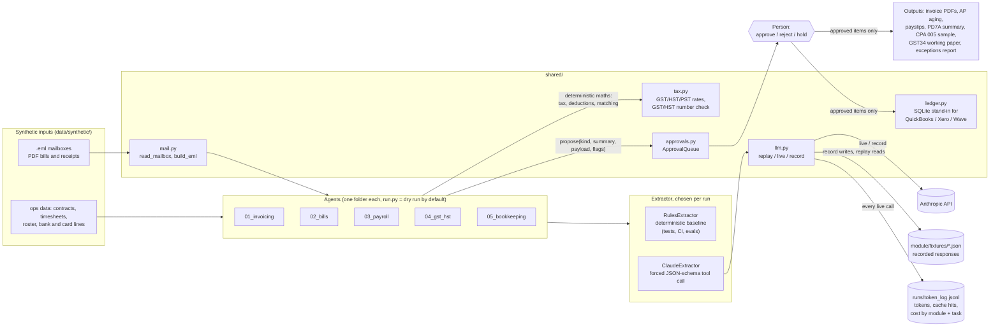
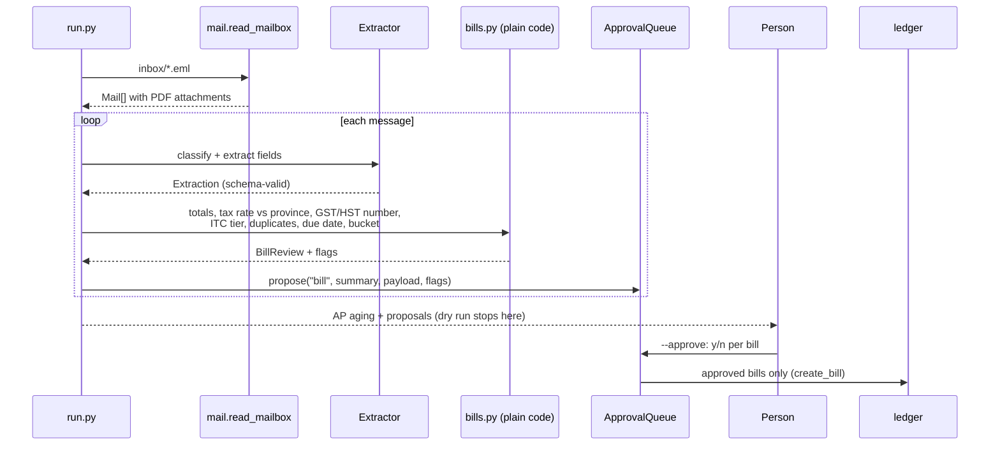

# Architecture

Five agents share one small library. Each agent reads documents, proposes changes, and stops. Nothing reaches the ledger, a payment file or a filing until a person approves it.

## The pieces

| Piece | What it does | Why it is shaped this way |
|---|---|---|
| `shared/llm.py` | One function, `extract()`, that forces a single tool call validated against a JSON schema. `AFO_LLM_MODE=replay` (default) reads a recorded response from disk, `live` calls the API, `record` calls it and saves the response. | Downstream code never parses prose. Tests and CI need no key and cost nothing. The system prompt (rules, chart of accounts) is marked for prompt caching because it repeats on every document in a run. |
| Token log | Every live call appends model, input/output/cache tokens, estimated cost and latency to `runs/token_log.jsonl`, tagged by module and task. `llm.token_report()` sums it by module. | Gives the cost side of an ROI case per automation, to set against the hours the job took by hand. |
| `shared/approvals.py` | `ApprovalQueue.propose()` records a summary, the payload that would be committed, and any flags. `review()` asks y/n per item; `auto=True` approves only unflagged items and holds the rest. | Agents propose, people approve. Flags are the agent's way of saying "a person must look at this". |
| `shared/ledger.py` | SQLite tables for customers, invoices, vendors, bills, transactions and pay runs, with integer cents. `update_customer` / `update_transaction` only touch whitelisted columns. New columns are added by idempotent migrations on connect. | A real adapter (QuickBooks, Xero) can replace it without changing agent logic. |
| `shared/tax.py` | Provincial GST/HST/PST rates, half-up rounding to the cent, GST/HST registration-number format and BN check digit. | Shared by invoicing, bills, GST/HST and bookkeeping so rates live in one place. |
| `shared/mail.py` | Reads `.eml` exports; builds them for the synthetic-data generators, with an optional pinned MIME boundary so fixtures are byte-identical across runs. | Stands in for an IMAP or Gmail adapter. |

## One run, end to end (02_bills)

